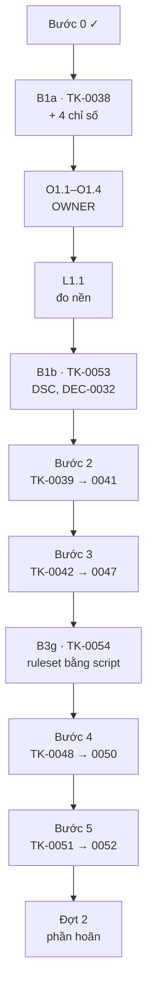

Bản tham khảo 2026-11-22. Nguồn hiện hành: SRC-0003 P6d, DEC-0032.
# Phương án tích hợp cơ chế GSD Core vào Kaizen Đợt 1 (CYC-08)

- Ngày lập: 2026-11-22.
- Rà lại lần 2 (2026-11-22):
  - Sửa số đếm task và cơ chế; đổi tên batch theo quy ước của SRC-0003 (B1b, B3g).
  - Sửa đường duyệt thay đổi ở TK-0038.
  - Thêm điều kiện khi lấy GSD (mục 6) và danh sách việc cần làm (mục 8).
  - Thêm ba điểm cần kiểm trong SRC-0003: cách ghi ở TK-0042, nơi chạy verify, các E chưa có task.
- Căn cứ:
  - Hiện trạng CYC-08: Bước 0 đã merge (TK-0036, TK-0037, DSC-20261121-kzn1, DEC-0031); Bước 1 đang chuẩn bị (TK-0038, O1.1–O1.4, L1.1).
  - Kế hoạch chi tiết `SRC-0003`: TK-0038 → TK-0052, mỗi batch một task (B0a…B5b).
  - `GSD_CORE_DE_XUAT_KAIZEN.md`: 17 cơ chế M1–M17 (mục 7: mâu thuẫn và điểm trùng với dự án).
  - Hồ sơ H0–H4 bản 2026-11-22: E27–E43 ứng với M1–M17.
- Giới hạn nguồn: hiện trạng lấy từ bản tóm tắt LEAD lập ngày 2026-11-22, không đọc trực tiếp SRC-0003. Các điểm ghi "cần kiểm" ở mục 8 là chỗ bản tóm tắt chưa đủ để kết luận.
- Trạng thái: ĐỀ XUẤT; OWNER chốt qua DSC và DEC-0032 (TK-0053) trước khi sửa phạm vi task. Riêng thay đổi ở TK-0038 đi theo mục 2.2.

---

## 1. Kết luận

1. **Không đưa vào trước L1.1 bất kỳ thay đổi nào về luật, ngữ cảnh hay công cụ mà LEAD đọc.** Nếu không, số nền bị lệch và Bước 5 không còn so được.
2. **TK-0038 đo thêm 4 chỉ số**, nội dung ba phiên giữ nguyên. Thay đổi này đi trong PR của chính TK-0038, vì nằm trong phạm vi đo nền mà DEC-0031 đã duyệt; không chờ DEC-0032 (đặt sau L1.1).
3. **13 trên 17 cơ chế có phần áp trong Đợt 1**, gộp vào 10 task có sẵn (TK-0040, 0042–0046, 0048–0050, 0052), cộng TK-0038 chỉ thêm chỉ số đo.
   - Áp trọn trong Đợt 1: M2, M10, M11, M14, M17.
   - Áp một phần, phần còn lại ở Đợt 2–4: M1, M3, M4, M5, M7, M9, M12, M13.
   - Hoãn hẳn sang Đợt 2: M6, M8, M15, M16.
4. **Thêm 2 batch, đều mức token nhẹ:** B1b (TK-0053, nạp quyết định) và B3g (TK-0054, ruleset bằng script). Có thể thêm 0–2 batch nếu phải tách TK-0042 hoặc TK-0045 vì write_scope.
5. **Không xung đột với DEC-0031.** E14 (tách tài khoản) còn là điều kiện để hook gác chặn mà không chặn nhầm OWNER, và để ruleset bằng script hoạt động.
6. **Lấy GSD có điều kiện** (mục 6): giữ khung kiểm soát của Hardness, chỉ lấy cơ chế thi hành bằng máy. DEC-0032 ghi các cơ chế không lấy là REJECTED để không đề xuất lại.
7. **Ba điểm phải kiểm trong SRC-0003 trước Bước 3:**
   - Cách ghi "actual_model" và "evidence.kind" ở TK-0042.
   - Nơi chạy verify chính thức: trên máy (TK-0046) hay trên CI.
   - Các E đã có trong H0 nhưng chưa thấy task (E20, E22, E24, E26, H3-4, H3-5, H4-11).

---

## 2. Trả lời ba câu hỏi neo

### 2.1. Nội dung mới chèn vào bước nào?

| Nhóm | Đặt vào | Lý do |
| --- | --- | --- |
| Chỉ số đo cho M1, M2, M4 | TK-0038 (B1a), trước L1.1 | Không đo bù được sau khi luật đổi |
| Quyết định nạp GSD (DSC, DEC-0032) | Batch mới **B1b** (TK-0053), sau L1.1, trước TK-0039 | DEC mới làm đổi mục DEC trong STATE mà LEAD đọc; đặt sau đo nền để không lệch số nền |
| Vùng AUTO trong STATE (M3) | Bước 2, TK-0040 | Cùng PR rút gọn STATE |
| Quy ước: mã thoát, lớp lỗi, ON_CRASH, schema kiểm lời tự báo (M9, M10, M11, M14) | Bước 3, TK-0042 | Đây đã là task quy ước; làm trước khi viết validate |
| Phép kiểm: lời tự báo, phủ DoD, đối chứng dương, state validate, sổ chỉ thêm dòng (M3, M7, M12, M14, M17) | Bước 3, TK-0043, TK-0044 | Cùng mã nguồn validate và kiểm trôi |
| CI, hook, quét injection (M11, M13, M17) | Bước 3, TK-0045 | Cùng file `.github/` và `tools/hooks/` |
| Tên file bí mật (M12) | Bước 3, TK-0046 | Cùng task cách ly verify |
| Ruleset bằng script (M17) | Batch mới **B3g** (TK-0054), sau TK-0047 | Cần tài khoản tác tử đã tách và cấu hình đã bật ở Bước 1 |
| Luật LEAD, độ sâu đọc, template checkpoint (M1, M2, M4, M5) | Bước 4, TK-0048, TK-0049 | Đúng phạm vi K2; được đo ở Bước 5 |
| Hàm đo C7, ratchet (M17) | TK-0050, TK-0052 | Đã là việc của hai task này |
| Định tuyến, leo bậc, ước lượng, kiểm định, sửa lỗi (M6, M8, M15, M16 và phần còn lại của M4, M5, M7, M9, M12, M13) | Đợt 2 | Cần W1–W4, số liệu token theo task, hạn mức tuyến |
| Payload `init`, `state sync`, task sửa từ gap (phần còn lại của M1, M3, M16) | Đợt 4 | Cùng script `get` và `state` |

Đường găng không đổi: Bước 2 → 3 → 4 → 5 vẫn tuần tự.

### 2.2. Có phải sửa spec TK-0038 không?

Có, nhưng chỉ **thêm chỉ số đo**, không đổi nội dung ba phiên.

| Chỉ số thêm | Đo ở phiên | Cơ chế dùng để chấm | Nguồn số liệu | Nếu không có nguồn |
| --- | --- | --- | --- | --- |
| Tỷ lệ output/input theo vai | Cả 3 | M1, M2 | `completion_tokens / prompt_tokens` từ usage, có nhãn vai | Bắt buộc có; L1.1 đã xuất usage theo vai |
| Số lần đọc nguyên file đặc tả hoặc luật | Phiên 1, 2 | M2 | Log lệnh gọi công cụ của phiên LEAD | Ghi "Chưa thu thập được" (README mục 5); không ước lượng |
| Số dòng nội dung WORKER trả về cho LEAD | Phiên 3 | M1 | Lượt trả về cuối trong file run | — |
| Đỉnh `prompt_tokens` của mỗi phiên | Cả 3 | M4 | Usage | Ghi số tuyệt đối; tỷ lệ trên ngân sách tuyến tính sau, khi MODEL_CATALOG có giới hạn context (Đợt 2) |

**Đường duyệt:**
- LEAD đưa bốn chỉ số vào chính PR của TK-0038; ghi trong mô tả PR là "bổ sung chỉ số đo theo PHUONG_AN_TICH_HOP_GSD_DOT1 mục 2.2".
- OWNER merge TK-0038 là duyệt. Không cần DEC mới, vì đây là thay đổi đo, không đổi luật hay ngữ cảnh, và nằm trong phạm vi đo nền của DEC-0031.
- Nếu LEAD cho rằng thay đổi vượt phạm vi DEC-0031: ghi một QUESTION trong DSC-20261121-kzn1; OWNER trả lời trước L1.1.

**Điều kiện giữ nguyên:** cùng model, cùng tuyến, cùng đầu vào, cùng điểm đo. Ghi chỉ số mới vào cùng bảng nền, cột riêng.

### 2.3. Có xung đột với DEC-0031 không?

| Quyết định trong DEC-0031 | Quan hệ với GSD | Ghi chú |
| --- | --- | --- |
| 1. Tạm dừng chu kỳ sản phẩm | Không xung đột | Cơ chế cho tuyến free (M8, M16) để Đợt 2, khi chu kỳ sản phẩm mở lại |
| 2. Kaizen lấy origin từ DEC | **Ràng buộc cách nạp** | Phải có DSC và DEC-0032 (B1b); ngoại lệ duy nhất là chỉ số đo ở TK-0038 (mục 2.2) |
| 3. Bật ruleset GitHub | Bổ trợ | M17 chuyển ruleset từ thao tác giao diện thành file JSON và script có bản ghi trong Git |
| 4. Run cũ chỉ kiểm từ mốc | Bổ trợ | Phép kiểm mới (M14, M7) cũng chỉ áp từ mốc; run cũ không bị đánh FAIL ngược |
| 5. Trường `model` dạng danh sách | Khớp | Kiểm lời tự báo và SAME_MODEL dùng danh sách model thực tế; cần sửa cách ghi "actual_model" ở TK-0042 |
| E14: tách tài khoản | **Điều kiện tiên quyết** | Có tài khoản tác tử riêng thì ruleset mới phân biệt được, hook gác DENY (M11) mới không chặn nhầm OWNER |
| E15: chuyển repo mẹ theo nhóm | Khớp | Nhóm E27–E43 chỉ chuyển về repo mẹ sau cổng Đ5-C |

---

## 3. Phương án chi tiết theo task

Ký hiệu: **Giữ** = task không đổi; **Mở rộng** = thêm việc vào phạm vi; **Mới** = batch mới. Mã E trong ngoặc là đề xuất trong H0.

### Bước 1 — Đo nền và cấu hình

| Task | Hành động | Nội dung |
| --- | --- | --- |
| TK-0038 (B1a) | Mở rộng nhẹ | Thêm 4 chỉ số ở mục 2.2 và điểm đo cố định vào `baseline_session_spec.md`; nội dung phiên giữ nguyên |
| O1.1–O1.4 | Giữ | OWNER làm trên giao diện như kế hoạch, kịp hạn RSK-0004 (2026-11-26). Sau khi bật, OWNER xuất cấu hình ruleset bằng `gh api` lưu ở `<project>.local`, làm mốc cho TK-0054 |
| L1.1 | Giữ | Chạy đúng spec đã mở rộng |

### Batch mới B1b — Nạp quyết định GSD (TK-0053, `lead/`, token nhẹ)

- **Vào:** L1.1 xong, đã có bảng nền.
- **Việc:**
  1. Nạp `GSD_CORE_DE_XUAT_KAIZEN.md` và file này vào `06_sources/` dạng SRC mới, qua quy trình sanitize như TK-0036.
  2. DSC mới ghi E27–E43 (H0 mục 3).
  3. DEC-0032:
     - ACCEPTED các E áp trong Đợt 1, kèm task (bảng mục 5).
     - Hoãn các E và phần E của Đợt 2–4.
     - REJECTED các cơ chế GSD không lấy (mục 6).
  4. Sửa phạm vi các task liên quan trong SRC-0003 theo mục 3 này.
  5. Sửa cách ghi ở TK-0042 (H4 mục 1): khóa `model` nhận danh sách mã catalog của model thực tế đã xác minh, bỏ chữ `actual_model`; khóa loại bằng chứng không đổi kiểu của `evidence`.
  6. Đếm write_scope của TK-0042 và TK-0045 sau khi mở rộng; vượt 5 path thì tách (bảng dưới).
  7. Đồng bộ H0–H4, README, KE_HOACH bản 2026-11-22 vào bản trong repo.
- **Xong khi:** DEC-0032 ACTIVE đã merge; SRC-0003 cập nhật phạm vi task.
- **OWNER:** 1 lượt merge; chốt các câu hỏi ở mục 7, gom vào cùng lượt duyệt.

### Bước 2 — Cắt tỉa

| Task | Hành động | Nội dung thêm từ GSD |
| --- | --- | --- |
| TK-0039 | Giữ | — |
| TK-0040 | Mở rộng | (a) Đánh dấu vùng trong STATE.md mà sau này script sinh tự động, bằng cặp chú thích `<!-- STATE:AUTO:START -->` … `END` (E29; chỉ đánh dấu, chưa sinh). (b) Catalog: thêm DeepSeek, Nvidia Nano ở trạng thái UNQUALIFIED nếu chưa làm |
| TK-0041 | Giữ | — |

### Bước 3 — Thi hành tự động

| Task | Hành động | Nội dung thêm từ GSD | Cơ chế, E |
| --- | --- | --- | --- |
| TK-0042 (`upgrade/`) | Mở rộng | `exit_codes.json` là nguồn duy nhất của mã thoát, thêm **66 NO_INPUT**. Enum lớp lỗi (quota, credit, incompatible, overloaded, unknown) và quy tắc đối chiếu sản phẩm trên đĩa trước khi phân loại lỗi. Quy ước `ON_CRASH = allow \| deny` cho mọi hook. Schema run thêm `files_created`, `commits`, `self_check`. Template điểm dừng thêm luật lệch kế hoạch chỉ trong write_scope và luật không thử tên gói gần giống | M9, M10, M11, M14; E4, E35, E36, E37, E40 |
| TK-0043 (`task/`) | Mở rộng | Kiểm lời tự báo cho mọi run (file khai có tồn tại; SHA là tổ tiên HEAD của đúng nhánh). Phủ DoD bằng test. Phép kiểm write_scope trả 66 khi diff rỗng và phát hiện danh sách file bị `gh` cắt ở 100. **Mỗi kiểm C phải có test đối chứng dương** mới được đếm vào "≥ 5/14" | M7, M10, M14, M17; E33, E36, E40, E43 |
| TK-0044 (`task/`) | Mở rộng | Kiểm "SHA STATE khớp" mở rộng thành `state validate` trên vùng AUTO. Thêm "sổ chỉ thêm dòng": diff trên file sổ (DEC, RSK, REQ, run) không có dòng bị xóa, trừ ngoại lệ khai trong task | M3, M12; E29, E38 |
| TK-0045 (`task/`, chạm `.github/`) | Mở rộng | Hook pre-push khai `ON_CRASH = deny`, hiểu mã 66 và mã 3. Quét injection và base64 trên file `.md` thay đổi, mức cảnh báo (chép `prompt-injection-scan.sh`, `base64-scan.sh` kèm NOTICE MIT; thay phần nạp `exit-codes.sh` bằng mã thoát của Hardness). Bước khẳng định runner do GitHub cung cấp: bắt buộc nếu verify chạy trên CI, tùy chọn nếu `check.yml` chỉ chạy validate | M11, M13, M17; E37, E39, E43 |
| TK-0046 (`upgrade/`) | Mở rộng | Quét tên file bí mật trong diff, **không phân biệt hoa thường** (`.env`, `.ENV`, `.secrets`). Ghi rõ: lần chạy lại verify do máy là nguồn duy nhất cho LEAD và REVIEWER; nơi chạy theo quyết định ở B1b | M12; E6, E38 |
| TK-0047 (`task/`) | Giữ | C9 đã đúng tinh thần `check-glossary-refs` của GSD | — |
| **TK-0054 (mới, B3g)** | Mới | Ruleset thành file JSON trong repo; script áp viết bằng Python (Git Bash không có `jq`, mà `sync-rulesets.sh` của GSD cần `jq`); chạy lại nhiều lần cho cùng kết quả; github_audit so cấu hình thật với khai báo. Luật thẻ có `creation`, `update`, `deletion`, chỉ OWNER bypass. Không dựa vào chế độ `evaluate` (CHƯA XÁC MINH cho repo cá nhân) | M17; E43 |

**Kiểm write_scope ≤ 5 path** (SRC-0003): TK-0042 và TK-0045 dễ vượt trần sau khi mở rộng. LEAD đếm ở B1b; nếu vượt thì tách:

| Task gốc | Phần tách ra | Task mới | Batch đề xuất |
| --- | --- | --- | --- |
| TK-0042 | `exit_codes.json` và enum lớp lỗi | TK-0055 | B3a2, ngay sau B3a |
| TK-0045 | Quét injection và base64 | TK-0056 | B3d2, ngay sau B3d |

Mã task cấp theo thứ tự tạo (ledger); tên batch do LEAD chốt.

### Bước 4 — Ngữ cảnh

| Task | Hành động | Nội dung thêm từ GSD | Cơ chế, E |
| --- | --- | --- | --- |
| TK-0048 | Mở rộng | Khi tách file: mỗi sổ và mỗi đặc tả có frontmatter đủ để ra quyết định; thân chỉ đọc khi chẩn đoán | M2; E28 |
| TK-0049 | Mở rộng | Trong LEAD.md ≤ 1.300 từ, thêm 4 luật (mỗi luật ≤ 40 từ): (1) chỉ đọc frontmatter, đọc thân khi chẩn đoán; (2) không nhét file lớn vào prompt của vai khác, chỉ trỏ đường dẫn; (3) vai con ghi kết quả ra file, trả 1 dòng; (4) chỉ tách hoặc bỏ việc vì ba lý do: quá ngân sách ngữ cảnh, thiếu thông tin, xung đột phụ thuộc. Template checkpoint theo cấu trúc `continue-here`; mỗi mục "đã xong" trỏ SHA hoặc hash | M1, M2, M4, M5; E27, E28, E30, E31 |
| TK-0050 | Mở rộng | C7 đo theo từ dùng **một hàm đo duy nhất** cho mọi nơi (test và báo cáo); có test đối chứng dương | M17; E43 |

### Bước 5 — Đo lại và đóng đợt

| Task | Hành động | Nội dung thêm từ GSD |
| --- | --- | --- |
| TK-0051 | Giữ | Chạy lại với spec đã mở rộng ở TK-0038 |
| TK-0052 | Mở rộng | (a) Báo cáo thêm 4 chỉ số ở mục 2.2, so nền. (b) Ghi mốc ratchet (chỉ đi một chiều, lùi phải có DEC): số từ LEAD.md, số luật, số DEC ACTIVE, token LEAD phiên chuẩn. (c) Ghi ACCEPTED hoặc REJECTED cho từng E27–E43 đã áp |

### Đợt 2 và sau — Phần hoãn

| Cơ chế | Phần hoãn | Đợt | Lý do |
| --- | --- | --- | --- |
| M4 (E30) | Script giám sát ngữ cảnh LEAD, ngưỡng 50% và 70% | 2 | Cần ngân sách context theo tuyến và số liệu Bước 5 |
| M5 (E31) | Ngưỡng cỡ task cho tuyến free; tiêu chí tách Cấp 3 | 2 | Cần W1–W4 và tuyến free đạt chuẩn |
| M6 (E32) | Ước lượng token có hiệu chỉnh | 2 | Cần ≥ 3 task có số token thực tế theo task |
| M7 (E33) | Phủ yêu cầu → task; checker ngữ nghĩa trước PLAN_GO | 2 | Dùng khi chu kỳ sản phẩm mở lại |
| M8 (E34) | Thang tier, `max_escalations` | 2 | Cần W1–W4 |
| M9 (E35) | Script phân loại theo mã HTTP; thang nhà cung cấp | 2 (tuyến free), 3 (mọi tuyến) | Cần hạn mức tuyến trong MODEL_CATALOG |
| M12 (E38) | Luật đọc trước khi sửa cho tuyến free | 2 | Đi cùng việc đưa tuyến free làm WORKER |
| M13 (E39) | Quét 06_sources/ ở mức chặn | 2 | Script `scan` là việc của Đợt 2 |
| M15 (E41) | Verifier ngược từ mục tiêu cho REVIEWER | 2 | Chu kỳ sản phẩm mở lại mới dùng |
| M16 (E42) | Node Repair (không PRUNE tự đóng), gap YAML | 2; sinh task từ gap ở 4 | Cần bảng lỗi đã chạy và REVIEWER mới |
| M1 (E27) | Payload `init` gọn cho từng vai | 4 | Cùng script `get` |
| M3 (E29) | `state sync` dựng lại STATE | 4 | Cùng script `state` |

---

## 4. Lộ trình sau điều chỉnh

| Thay đổi | Số batch thêm | Token thêm |
| --- | --- | --- |
| B1b (TK-0053) | 1 | Nhẹ |
| B3g (TK-0054) | 1 | Nhẹ đến vừa |
| Tách TK-0042, TK-0045 nếu vượt write_scope (B3a2, B3d2) | 0–2 | Nhẹ |
| Mở rộng 10 task có sẵn và TK-0038 | 0 | Tăng chủ yếu ở TK-0042, TK-0043, TK-0045 |

**Việc OWNER phát sinh thêm:**
- 2 lượt merge (B1b, B3g), cộng 0–2 nếu phải tách task.
- Chốt các câu hỏi ở mục 7, gom vào lượt duyệt B1b.
- Xuất cấu hình ruleset sau O1.x (một lệnh `gh api`).

---

## 5. Bảng mã E27–E43

| Mã | Cơ chế | Áp trong Đợt 1 | Phần sau Đợt 1 |
| --- | --- | --- | --- |
| E27 | M1 Vai con ghi file, trả 1 dòng | TK-0049 | Đợt 4: payload `init` |
| E28 | M2 Độ sâu đọc theo frontmatter | TK-0048, TK-0049 | — |
| E29 | M3 Vùng AUTO trong STATE, `state validate` | TK-0040, TK-0044 | Đợt 4: `state sync` |
| E30 | M4 Luật dừng ở ranh giới batch, template checkpoint; đo đỉnh prompt_tokens | TK-0038, TK-0049 | Đợt 2: script giám sát |
| E31 | M5 Luật ba lý do tách việc | TK-0049 | Đợt 2: ngưỡng cỡ task |
| E32 | M6 Ước lượng token có hiệu chỉnh | — | Đợt 2 |
| E33 | M7 Phủ DoD bằng test | TK-0043 | Đợt 2: phủ yêu cầu, checker |
| E34 | M8 Thang tier, `max_escalations` | — | Đợt 2 |
| E35 | M9 Enum lớp lỗi, đối chiếu đĩa trước khi phân loại | TK-0042 | Đợt 2–3: script, thang nhà cung cấp |
| E36 | M10 Sổ mã thoát một nguồn, mã 66 | TK-0042, TK-0043 | — |
| E37 | M11 Khai báo `ON_CRASH` bắt buộc | TK-0042, TK-0045 | — |
| E38 | M12 Tên file bí mật không phân biệt hoa thường; sổ chỉ thêm dòng | TK-0044, TK-0046 | Đợt 2: đọc trước khi sửa |
| E39 | M13 Quét injection, base64 trên PR | TK-0045 | Đợt 2: 06_sources/ mức chặn |
| E40 | M14 Kiểm lời tự báo cho mọi run | TK-0042, TK-0043 | — |
| E41 | M15 Verifier ngược từ mục tiêu | — | Đợt 2 |
| E42 | M16 Node Repair, gap YAML | — | Đợt 2; task từ gap ở Đợt 4 |
| E43 | M17 Ruleset bằng code; đối chứng dương; runner guard; ratchet | O1.x (xuất cấu hình), TK-0043, 0044, 0045, 0050, 0052, 0054 | — |

Quan hệ với E cũ:
- E36 và E37 cụ thể hóa câu hỏi E16.
- E40 đưa kiểm lời tự báo của E17 lên Bước 3, cho mọi tuyến.
- E34, E35, E42 tách thang leo của E17 thành hai thang (năng lực, nhà cung cấp) và thêm bước tách task trước khi leo.

---

## 6. Điều kiện khi lấy GSD vào Hardness

Rút từ đối chiếu mâu thuẫn và điểm trùng (`GSD_CORE_DE_XUAT_KAIZEN.md` mục 7). Nguyên tắc: giữ khung kiểm soát của Hardness (cổng OWNER, sổ DEC, write_scope, REVIEWER khác model); lấy cơ chế tự động hóa của GSD để thi hành khung đó bằng máy.

| # | Điều kiện | Áp ở |
| --- | --- | --- |
| 1 | Luật lệch kế hoạch của executor GSD (tự sửa lỗi, tự thêm phần thiết yếu, tự gỡ chặn) chỉ áp **trong write_scope**; ngoài phạm vi hoặc đổi kiến trúc thì dừng, báo BLOCK | TK-0042 (template) |
| 2 | Hook gác khai `ON_CRASH = deny`; hook quan sát `allow`. GSD chọn `allow` cho cả 11 hook vì có người ngồi trước máy; WORKER của Hardness chạy không giám sát | TK-0042, TK-0045 |
| 3 | Node Repair không có PRUNE tự đóng; PRUNE luôn thành BLOCK lên LEAD | Đợt 2 |
| 4 | Không tự hoãn gap; chỉ hoãn khi có ID task hoặc DEC cụ thể | Đợt 2 |
| 5 | Checkpoint người duyệt giữa lúc chạy của GSD chuyển thành BLOCK kèm QUESTION, gom lên OWNER theo batch | TK-0042 (template) |
| 6 | WORKER không ghi STATE, ROADMAP; công cụ `state validate`, `state sync` chỉ script chạy | TK-0044, Đợt 4 |
| 7 | Ngưỡng số của GSD (50%, 40%, 35%/25%) chỉ là điểm khởi đầu; hiệu chỉnh bằng số liệu CYC-08 | Đợt 2 |
| 8 | Khi tham khảo GSD, đọc code và workflow, không đọc tài liệu giải thích: hai chỗ trong tài liệu của GSD đã lệch với code (commit `--no-verify`, thời hạn khóa STATE) | Mọi task |

**Cơ chế không lấy** (ghi REJECTED trong DEC-0032):
- `git.branching_strategy: none`.
- `workflow.worktree_skip_hooks` (commit `--no-verify`).
- Checkpoint `checkpoint:human-verify` chen giữa lúc chạy.
- PRUNE tự đóng task; verifier tự hoãn gap.
- `ON_CRASH = allow` cho hook gác.
- Bộ cài npm, `gsd-tools.cjs` nguyên khối, hook theo sự kiện riêng của Claude Code.

---

## 7. Câu hỏi OWNER cần chốt ở B1b

1. **Mã 66 NO_INPUT:** thêm vào hệ 0/1/2/3 (khuyến nghị), hay gộp vào mã 3?
2. **Hook gác khi tự lỗi:** chặn (DENY, khuyến nghị cho WORKER chạy không giám sát) hay cho qua như GSD?
3. **Script quét của GSD:** chép `prompt-injection-scan.sh`, `base64-scan.sh` kèm NOTICE ghi công MIT và sửa phần mã thoát (khuyến nghị, rẻ), hay viết lại bằng Python?
4. **Nơi chạy verify chính thức:** cách ly trên máy như SRC-0003 (TK-0046), hay thêm verify trên CI như KE_HOACH đề xuất? Câu trả lời quyết định bước khẳng định runner ở TK-0045 là bắt buộc hay tùy chọn.

---

## 8. Danh sách việc cần làm

| # | Việc | Ai | Trước mốc | Trạng thái |
| --- | --- | --- | --- | --- |
| 1 | O1.1–O1.4: ruleset main và thẻ `cycle/*` (chặn tạo, sửa, xóa; chỉ OWNER bypass), quyền tối thiểu cho tài khoản tác tử, secret scanning, push protection | OWNER | 2026-11-26 (RSK-0004) | Chưa |
| 2 | Xuất cấu hình ruleset bằng `gh api`, lưu ở `<project>.local` | OWNER | TK-0054 | Chưa |
| 3 | Thêm 4 chỉ số và điểm đo cố định vào spec TK-0038, trong PR của TK-0038 | LEAD | L1.1 | Chưa |
| 4 | Kiểm có log lệnh gọi công cụ của phiên LEAD không; không có thì chỉ số "đọc nguyên file" ghi "Chưa thu thập được" | LEAD | L1.1 | Cần kiểm |
| 5 | Nếu thấy chỉ số mới vượt phạm vi DEC-0031: ghi QUESTION trong DSC-20261121-kzn1 để OWNER trả lời | LEAD | L1.1 | Tùy |
| 6 | Chạy L1.1 theo spec đã mở rộng | LEAD | B1b | Chưa |
| 7 | TK-0053: SRC cho hai tài liệu GSD; DSC E27–E43; DEC-0032 (ACCEPTED kèm task, hoãn, REJECTED) | LEAD, OWNER | TK-0039 | Chưa |
| 8 | Sửa cách ghi ở TK-0042: bỏ `actual_model`, dùng khóa `model` dạng danh sách (E21; quyết định chặn 5) | LEAD | TK-0053 | Cần kiểm nguyên văn SRC-0003 |
| 9 | Kiểm `evidence.kind` ở TK-0042 có đổi kiểu của khóa `evidence` không (H4 mục 1 cấm); nếu có, dùng khóa riêng | LEAD | TK-0053 | Cần kiểm |
| 10 | Chốt nơi chạy verify chính thức (câu hỏi 4, mục 7) | OWNER | TK-0053 | Chưa |
| 11 | Đếm write_scope TK-0042, TK-0045 sau mở rộng; vượt 5 path thì tách (TK-0055, TK-0056) | LEAD | TK-0053 | Chưa |
| 12 | Đối chiếu E1–E26 với DSC-20261121-kzn1: ghi trạng thái từng dòng E vào H0; với E chưa thấy task trong SRC-0003 (E20, E22, E24, E26, H3-4, H3-5, H4-11), ghi task hoặc ghi hoãn | LEAD | TK-0053 | Chưa |
| 13 | Đồng bộ bộ file cập nhật 2026-11-22 (H0–H4, README, KE_HOACH) với bản trong repo (`05_memory/upstream/`, `KE_HOACH_KAIZEN_DOT_1.md`), giữ phần đã sanitize | LEAD | TK-0053 | Chưa |
| 14 | Xác nhận ảnh chụp môi trường (H4-5), thứ tự prefix (H3-2), nén output (H3-7) nằm ở task nào trong SRC-0003 | LEAD | TK-0053 | Cần kiểm |
| 15 | Nếu chép script quét của GSD: thay phần nạp `exit-codes.sh` bằng mã thoát Hardness; thêm NOTICE MIT | LEAD | TK-0045 | Chưa |
| 16 | Nếu chọn verify trên CI: kiểm runner do GitHub cung cấp miễn phí cho repo public | LEAD | TK-0045 | GIẢ ĐỊNH |
| 17 | Kiểm Codex CLI, Orca có cơ chế hook chạy trước lệnh không (nếu có, nhiều rào chuyển được từ kiểm sau sang chặn trước) | LEAD | Đợt 2 | CHƯA XÁC MINH |

---

## 9. Rủi ro và cách giữ an toàn

| Rủi ro | Cách giữ |
| --- | --- |
| Mở rộng task làm Bước 3 nặng thêm, dễ chạm điểm dừng "báo sai > 20%" | Mọi phép kiểm mới chạy ở chế độ cảnh báo trước; đối chứng dương bắt buộc giúp phát hiện cổng hỏng sớm |
| DEC-0032 làm đổi ngữ cảnh LEAD giữa nền và đo lại | B1b đặt sau L1.1; mọi thay đổi ngữ cảnh đều nằm trong Bước 2–4 và được đo ở Bước 5 như kế hoạch |
| Thay đổi TK-0038 bị coi là đổi phạm vi không có DEC | Chỉ thêm chỉ số đo, không đổi phiên; ghi rõ trong mô tả PR; nếu nghi ngờ thì hỏi qua QUESTION trước L1.1 (mục 2.2) |
| Hạn RSK-0004 (2026-11-26) bị trễ vì chờ phương án GSD | O1.1–O1.4 làm ngay trên giao diện, không chờ; TK-0054 chỉ chuyển cấu hình đã có thành file và script |
| write_scope vượt 5 path ở TK-0042, TK-0045 | LEAD đếm ở B1b; vượt thì tách (TK-0055, TK-0056) |
| Hiện trạng lấy từ bản tóm tắt, có thể lệch SRC-0003 thật | Các điểm "cần kiểm" ở mục 8 được xử lý trong TK-0053, trước khi sửa phạm vi task |
| Ngưỡng và mẫu của GSD đo trên dự án khác (TypeScript, 200K) | Đợt 1 chỉ lấy cơ chế tất định; mọi ngưỡng số để Đợt 2, hiệu chỉnh bằng số liệu CYC-08 |
