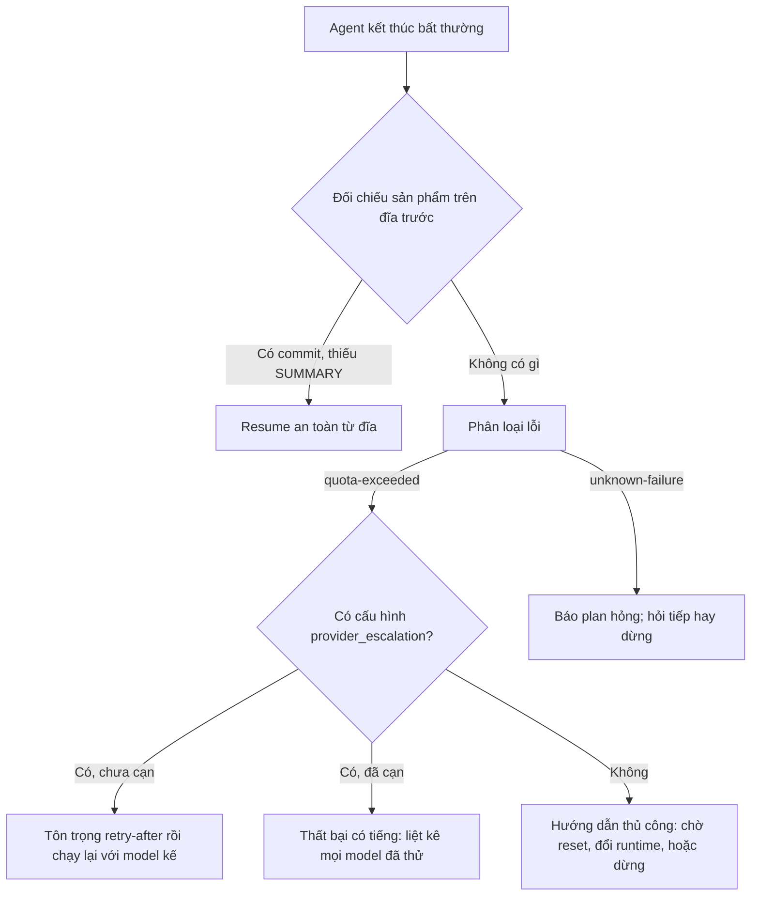
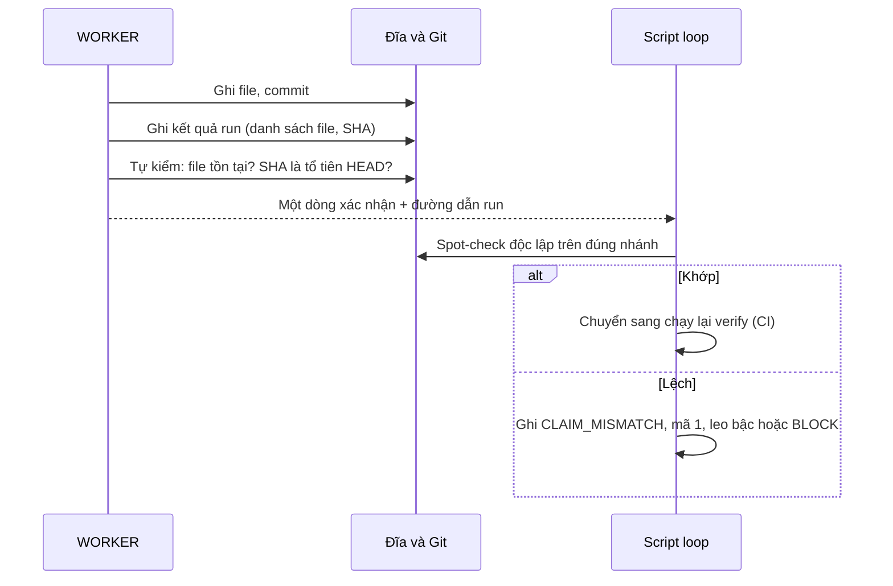
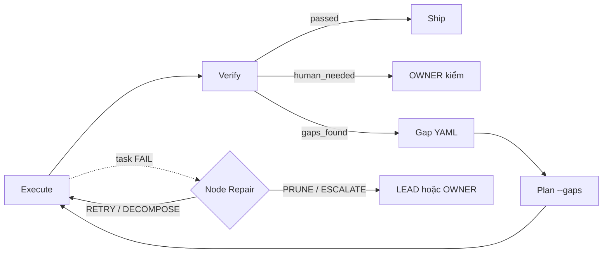
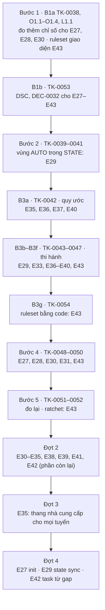

Bản tham khảo 2026-11-22. Nguồn hiện hành: SRC-0003 P6d, DEC-0032.Sanitize TK-0058 (2026-11-24): thay câu injection mẫu tiếng Anh trong ví dụ base64 bằng mô tả tiếng Việt (nghĩa không đổi; tránh rule override_en_ignore).

# Trích xuất cơ chế từ GSD Core cho kế hoạch Kaizen khung Hardness

- Nguồn phân tích: `open-gsd/gsd-core`, commit `663f9ad` (2026-11-22), giấy phép MIT.
- Đối chiếu với: `KE_HOACH_KAIZEN.md`, hồ sơ Upstream H0–H4 (E1–E26), bản cập nhật 2026-11-21; hiện trạng CYC-08 (bản tóm tắt của LEAD ngày 2026-11-22).
- Mục đích: tài liệu brainstorming với Tech Lead; chọn cơ chế nào đưa vào kế hoạch, ở bước nào, với mức ưu tiên nào.
- Quy ước trích dẫn: `đường_dẫn:dòng` theo commit trên. Mã TypeScript/JavaScript được trích nguyên văn (có lược bớt); mã Python là bản phác cho Hardness, chưa chạy thử.
- Cập nhật 2026-11-22 (rà lại):
  - Đối chiếu lại với code: sửa M1 (commit `--no-verify`), M12 (mô tả `gsd-write-guard`, `gsd-read-guard`), M13 (phụ thuộc của script bash), M17 (ruleset là file JSON, script cần `jq`); bổ sung M7 (dừng sớm khi vòng sửa không tiến).
  - Đồng bộ vị trí tích hợp với task của CYC-08 (TK-0038…TK-0054) và `PHUONG_AN_TICH_HOP_GSD_DOT1.md`.
  - Thêm mục 7: mâu thuẫn và điểm trùng với dự án.
- Mã E chính thức: M1–M17 tương ứng E27–E43 (H0 mục 3).

---

## Mục lục

- [0. Tóm tắt điều hành](#0-tóm-tắt-điều-hành)
- [1. Nguyên tắc chọn lọc và thang ưu tiên](#1-nguyên-tắc-chọn-lọc-và-thang-ưu-tiên)
- [2. Context Engineering và bộ nhớ dùng chung](#2-context-engineering-và-bộ-nhớ-dùng-chung)
  - [M1. Orchestrator mỏng, subagent ngữ cảnh mới, payload init](#m1-orchestrator-mỏng-subagent-ngữ-cảnh-mới-payload-init)
  - [M2. Luật độ sâu đọc theo cửa sổ ngữ cảnh](#m2-luật-độ-sâu-đọc-theo-cửa-sổ-ngữ-cảnh)
  - [M3. STATE.md sinh từ lược đồ, khóa ghi, validate/sync](#m3-statemd-sinh-từ-lược-đồ-khóa-ghi-validatesync)
  - [M4. Bậc suy giảm ngữ cảnh, giám sát và continue-here](#m4-bậc-suy-giảm-ngữ-cảnh-giám-sát-và-continue-here)
- [3. Quy tắc chia nhỏ việc](#3-quy-tắc-chia-nhỏ-việc)
  - [M5. Ngưỡng kích thước plan và giới hạn quyền của planner](#m5-ngưỡng-kích-thước-plan-và-giới-hạn-quyền-của-planner)
  - [M6. Ước lượng token có hiệu chỉnh](#m6-ước-lượng-token-có-hiệu-chỉnh)
  - [M7. Plan-checker đa chiều và vòng sửa kế hoạch](#m7-plan-checker-đa-chiều-và-vòng-sửa-kế-hoạch)
- [4. Định tuyến động và leo thang](#4-định-tuyến-động-và-leo-thang)
  - [M8. Thang năng lực light → standard → heavy](#m8-thang-năng-lực-light--standard--heavy)
  - [M9. Bộ phân loại lỗi và thang nhà cung cấp](#m9-bộ-phân-loại-lỗi-và-thang-nhà-cung-cấp)
- [5. Tự động hóa, hook và kiểm soát chất lượng](#5-tự-động-hóa-hook-và-kiểm-soát-chất-lượng)
  - [M10. Sổ đăng ký mã thoát một nguồn](#m10-sổ-đăng-ký-mã-thoát-một-nguồn)
  - [M11. Chính sách khi hook tự lỗi, bắt buộc khai báo](#m11-chính-sách-khi-hook-tự-lỗi-bắt-buộc-khai-báo)
  - [M12. Rào ở tầng công cụ thay cho luật văn xuôi](#m12-rào-ở-tầng-công-cụ-thay-cho-luật-văn-xuôi)
  - [M13. Quét injection dùng chung bộ mẫu](#m13-quét-injection-dùng-chung-bộ-mẫu)
  - [M14. Self-check và spot-check lời tự báo](#m14-self-check-và-spot-check-lời-tự-báo)
  - [M15. Verifier ngược từ mục tiêu](#m15-verifier-ngược-từ-mục-tiêu)
  - [M16. Gap closure và Node Repair](#m16-gap-closure-và-node-repair)
  - [M17. Ruleset dưới dạng code và đối chứng dương cho cổng](#m17-ruleset-dưới-dạng-code-và-đối-chứng-dương-cho-cổng)
- [6. Bản đồ tích hợp vào kế hoạch](#6-bản-đồ-tích-hợp-vào-kế-hoạch)
- [7. Mâu thuẫn và điểm trùng với dự án](#7-mâu-thuẫn-và-điểm-trùng-với-dự-án)
- [8. Những gì không lấy và lý do](#8-những-gì-không-lấy-và-lý-do)
- [9. Câu hỏi cho buổi brainstorming](#9-câu-hỏi-cho-buổi-brainstorming)

---

## 0. Tóm tắt điều hành

GSD Core là một framework meta-prompting và spec-driven development, điều phối các coding agent (Claude Code, Codex, OpenCode…) qua vòng Discuss → Plan → Execute → Verify → Ship. Nó giải cùng bài toán với Hardness: model làm việc dài thì chất lượng giảm, không có bộ nhớ giữa phiên, và không có gì kiểm rằng việc đã thật sự xong.

Điểm khác cốt lõi: GSD giải bằng **code chạy tất định quanh agent**, không bằng thêm luật văn xuôi. Câu chú thích trong `hooks/gsd-agent-isolation-guard.js` tóm đúng tinh thần này:

> "A prose backstop cannot fix a prose defect — it is the same class of artifact the model may equally skip."

Đây cũng là chẩn đoán đã có cho Hardness: 46 luật, 13.600 từ đặc tả (D3), tác tử vẫn tự đẩy thẻ dù luật cấm (S5).

17 cơ chế được chọn, gom theo bốn khu vực:

| Khu vực | Cơ chế | Ưu tiên cao nhất | Đặt vào |
| --- | --- | --- | --- |
| Context và bộ nhớ | M1–M4 | P0: M3 (STATE validate) | Bước 1–4 (TK-0038, 0040, 0044, 0048, 0049), Đợt 2, Đợt 4 |
| Chia nhỏ việc | M5–M7 | P0: M7 (phủ DoD bằng test) | Bước 3–4 (TK-0043, 0049), Đợt 2 |
| Định tuyến và leo thang | M8–M9 | P0: M9 (enum lớp lỗi) | Bước 3 (TK-0042), Đợt 2–3 |
| Tự động hóa và chất lượng | M10–M17 | P0: M10, M11, M14, M17 | Bước 1, 3, 4, 5 |

Ba việc nên làm trước, vì chúng chốt luôn các đề xuất đang treo:

1. **M10 + M11**: sổ mã thoát một nguồn và chính sách crash bắt buộc khai báo. Chốt E5, E16, E18.
2. **M14**: self-check và spot-check. Biến CLAIM_MISMATCH (H3-16) thành phép kiểm chạy được ngay, cho mọi tuyến chứ không riêng tuyến free.
3. **M17**: test đối chứng dương cho mọi cổng, để `validate` không thành cổng giả; và ruleset bằng code. Ruleset vẫn bật bằng giao diện ngay ở Bước 1 để kịp hạn RSK-0004, rồi chuyển thành file JSON và script ở TK-0054.

---

## 1. Nguyên tắc chọn lọc và thang ưu tiên

**Nguyên tắc chọn:**

- Lấy **thiết kế và quy tắc**, viết lại bằng Python cho Hardness. Không cài GSD: nó chạy bằng Node/npm, nằm ngoài danh sách binary nền (E24), và nhiều hook gắn với sự kiện riêng của Claude Code.
- Script `.sh` của GSD chạy được bằng Git Bash (đi kèm Git, đã trong danh sách nền) nhưng **không chép nguyên được**:
  - Các script quét đều nạp (`source`) file mã thoát sinh tự động `gsd-core/bin/shared/exit-codes.sh`; phải thay bằng mã thoát của Hardness (M10).
  - `base64-scan.sh` cần `timeout` hoặc `perl`; cả hai có trong Git Bash.
  - `sync-rulesets.sh` cần `jq`, không có trong Git Bash và ngoài danh sách binary nền.
  - Khi chép phải giữ ghi công MIT (file LICENSE của GSD).
- Mỗi cơ chế phải trỏ được tới một sự cố (S), số liệu (D) hoặc đề xuất (E) đã có của Hardness. Không lấy thứ chỉ "hay".

**Thang ưu tiên:**

| Mức | Nghĩa | Thời điểm |
| --- | --- | --- |
| P0 | Chặn hoặc giảm rủi ro đã xảy ra; là tiền đề của bước sau | Đợt 1, Bước 1–3 |
| P1 | Tăng hiệu quả rõ, có số đo; không chặn bước khác | Đợt 1 Bước 4, hoặc Đợt 2 |
| P2 | Hữu ích khi quy mô lớn hơn | Đợt 3–4 hoặc sau |

**Hệ mã dùng trong tài liệu:** S1–S8 sự cố; D1–D5 số liệu; E1–E43 đề xuất Upstream (M1–M17 tương ứng E27–E43); Đ1–Đ5 là Bước 1–5 của Đợt 1; TK-nnnn và B0a…B5b là task và batch của CYC-08; T0–T2 hạng task; W1–W4 phép kiểm tuyến (xem `README_GOI_KAIZEN.md` mục 1.1).

---

## 2. Context Engineering và bộ nhớ dùng chung

### M1. Orchestrator mỏng, subagent ngữ cảnh mới, payload init

#### 1. Cơ chế hoạt động

**Bản chất.** Phiên chính (orchestrator) không đọc mã nguồn, không viết code, không diễn giải kết quả ngoài việc định tuyến. Việc nặng giao cho subagent, mỗi subagent bắt đầu với cửa sổ ngữ cảnh sạch (GSD giả định 200K) và chỉ nhận đúng những file nó cần.

**Vòng đời** (`docs/explanation/multi-agent-orchestration.md`):

```text
Orchestrator (workflow .md)
  ├── Load context   gsd-tools.cjs init <workflow> <phase>   → JSON gọn
  ├── Resolve model  gsd-tools.cjs resolve-model <agent>      → tier/model
  ├── Spawn agent    agents/*.md + init JSON + model + tools được phép
  ├── Collect result (subagent đã ghi kết quả ra file)
  └── Update state   gsd-tools.cjs state update / patch / advance-plan
```

**Luồng dữ liệu.** Mọi thứ đi qua đĩa trong `.planning/`, không qua hội thoại. Subagent không thấy trạng thái chưa ghi của orchestrator; vì vậy mọi đầu vào phải nằm trên đĩa trước khi spawn. Các agent loại mapper/classifier được dặn: *"Write documents directly … Return confirmation only. DO NOT include document contents."* (`agents/gsd-codebase-mapper.md:23,187`).

**Thực thi song song theo wave.** Orchestrator đọc `depends_on` của từng PLAN.md, xếp wave theo tô-pô; trong một wave các executor chạy song song, mỗi executor trong một worktree riêng. Hook chạy **ở mọi commit** theo mặc định (`workflows/execute-phase.md:703`, #2924). Chỉ khi bật tùy chọn `workflow.worktree_skip_hooks` thì executor mới commit với `--no-verify` và hook chạy một lần sau wave (`execute-phase.md:835`); kể cả khi đó, hook sau wave lỗi chỉ in cảnh báo.

> Lưu ý: `docs/explanation/multi-agent-orchestration.md` vẫn mô tả cách cũ (mọi executor commit `--no-verify`, hook chạy một lần mỗi wave). Workflow đã đổi; tài liệu giải thích chưa theo kịp. Xem mục 7.2.

#### 2. Lý do chọn

- **Nỗi đau Hardness:** D1 cho thấy LEAD đọc ~94K token mỗi request nhưng chỉ viết ~0,45%; tức LEAD chủ yếu đang *đọc thay script*. Đây đúng là bệnh M1 chữa.
- **Vượt trội so với cách thường:** "dặn LEAD tóm tắt cho ngắn" vẫn bắt LEAD đọc trước rồi mới tóm. Mẫu "subagent ghi file, trả 1 dòng" cắt chi phí ngay ở đầu vào của LEAD.
- Khớp với kết luận B1 của bản tư vấn 2026-11-20: LEAD Điều phối nên là máy trạng thái, LLM chỉ được gọi cho ngoại lệ.

#### 3. Vị trí tích hợp

| Thành phần Hardness | Thay đổi | Ưu tiên | Task | Phụ thuộc |
| --- | --- | --- | --- | --- |
| Luật LEAD, WORKER, REVIEWER | Quy ước trả về: vai con ghi kết quả ra file trong run, trả một dòng xác nhận kèm đường dẫn và hash | P1 | TK-0049 (Bước 4) | Raw capture (E22) |
| Đo nền | Tỷ lệ output/input theo vai; số dòng WORKER trả về | P0 | TK-0038 (Bước 1) | Usage có nhãn vai |
| Script điều phối | Lệnh `init <vai> <task>` trả JSON gọn: task spec, write_scope, model đã xác minh, kết quả preflight | P2 | Đợt 4, cùng script `get` | Schema run mới (TK-0042) |

Không lấy cách "commit `--no-verify`, hook chạy một lần mỗi wave": đó là tùy chọn ngoại lệ của GSD; Hardness giữ hook ở mọi lần đẩy (pre-push, TK-0045).

#### 4. Nghiệm thu và rủi ro

**Nghiệm thu:**
- Tỷ lệ output/input của phiên LEAD trong phiên chuẩn Bước 5 cao hơn mốc 0,45%.
- Không lượt trả về nào của WORKER, REVIEWER chứa nguyên văn nội dung file (script kiểm độ dài trả về ≤ N dòng).

**Rủi ro:**
- Subagent ghi file sai chỗ hoặc ghi rỗng rồi báo xong. *Giảm thiểu:* M14 spot-check kiểm file tồn tại và có nội dung.
- Mất thông tin ngầm giữa các vai. *Giảm thiểu:* DEC ghi kèm lý do; HANDOFF có trường `decisions`, `assumptions`.

---

### M2. Luật độ sâu đọc theo cửa sổ ngữ cảnh

#### 1. Cơ chế hoạt động

`gsd-core/references/context-budget.md` đặt năm luật cho mọi workflow có spawn agent:

1. Không đọc file định nghĩa agent (runtime tự nạp).
2. Không nhét file lớn vào prompt của subagent; bảo subagent tự đọc từ đĩa.
3. **Độ sâu đọc theo cửa sổ:**

| Cửa sổ | Đầu ra subagent | SUMMARY.md | VERIFICATION.md | PLAN.md phase khác |
| --- | --- | --- | --- | --- |
| < 500K (mặc định 200K) | Chỉ frontmatter | Chỉ frontmatter | Chỉ frontmatter | Chỉ phase hiện tại |
| ≥ 500K | Được đọc đủ | Được đọc đủ | Được đọc đủ | Chỉ phase hiện tại |

4. Giao việc nặng cho subagent.
5. Đã tiêu nhiều ngữ cảnh thì chủ động cảnh báo và gợi ý checkpoint.

Thiếu trường `context_window` trong cấu hình thì coi là 200K (mặc định thận trọng).

Tài liệu cũng chỉ ra ba **dấu hiệu suy giảm sớm**, trước khi chạm ngưỡng:
- Báo xong nhưng làm chưa đủ.
- Ngôn ngữ mơ hồ dần ("xử lý phù hợp", "theo mẫu chuẩn").
- Bỏ bước: tiêu chí có 8 mục nhưng chỉ báo 5.

#### 2. Lý do chọn

- **Nỗi đau:** D3, đặc tả 13.600 từ, ít neo nên tác tử đọc nguyên file.
- Luật "chỉ đọc frontmatter" biến sổ Markdown của Hardness thành dữ liệu có cấu trúc: YAML đầu file là thứ LEAD đọc, phần thân chỉ đọc khi chẩn đoán. Không cần công cụ mới, chỉ cần quy ước và script trích.
- Ba dấu hiệu suy giảm sớm là chất liệu trực tiếp cho W2 (trong giới hạn) và W3 (báo thật) của tuyến free.

#### 3. Vị trí tích hợp

- `harness/rules/LEAD.md` bản rút gọn (Bước 4): thêm 3 luật đọc (1, 2, 3) dưới dạng con trỏ, không chép lại thân.
- Thứ tự nạp prefix (H3-2): frontmatter của sổ nằm ở khối ổn định; thân chỉ nạp theo yêu cầu.
- Định nghĩa W2, W3 (E19, Đợt 2): dùng ba dấu hiệu suy giảm làm tiêu chí chấm.
- **Ưu tiên P1.** Phụ thuộc: sổ có YAML đầu file đúng lược đồ (check-jsonschema, H4-11).

#### 4. Nghiệm thu và rủi ro

**Nghiệm thu:**
- Số lần đọc nguyên file đặc tả trong phiên chuẩn Bước 5 giảm so với Bước 1 (đếm từ log công cụ).
- Mỗi loại sổ (task, run, DEC) có frontmatter đủ để LEAD ra quyết định định tuyến mà không đọc thân.

**Rủi ro:**
- LEAD ra quyết định thiếu thông tin vì chỉ đọc frontmatter. *Giảm thiểu:* frontmatter phải chứa trạng thái, kết luận, con trỏ bằng chứng; mục nào cần đọc thân thì ghi cờ `needs_review: true`.

---

### M3. STATE.md sinh từ lược đồ, khóa ghi, validate/sync

#### 1. Cơ chế hoạt động

**Ba lớp:**

1. **Lược đồ một nguồn.** Phần frontmatter của STATE.md được sinh từ `STATE_FIELD_SCHEMA` (`src/state-md-schema.cts`) bằng `scripts/gen-state-md-docs.cjs`. Vùng sinh tự động được đánh dấu, cấm sửa tay:

```markdown
<!-- STATE-MD-SCHEMA:START:frontmatter — generated by scripts/gen-state-md-docs.cjs … do not edit by hand -->
---
gsd_state_version: '1.0'
status: planning
progress:
  total_phases: 0
  completed_phases: 0
  total_plans: 0
  completed_plans: 0
  percent: 0
---
<!-- STATE-MD-SCHEMA:END:frontmatter -->
```

2. **Khóa ghi nguyên tử** (`src/state.cts:4370+`, `acquireStateLock`): tạo `STATE.md.lock` bằng `O_CREAT | O_EXCL`, ghi PID vào thân khóa. Quyết định "cướp khóa" có bốn nhánh:

```ts
// src/state.cts (lược)
const retryDelay = 200;          // ms, cộng jitter 0–50ms
const maxWaitMs = 30000;         // ngân sách chờ
const deadmanCeilingMs = 60000;  // trần tuyệt đối, > maxWaitMs
const freshCreateFloorMs = 1000; // khóa rỗng trẻ hơn mức này = đang tạo dở

if (holderLive)            steal = ageMs > deadmanCeilingMs; // chủ khóa còn sống: chỉ cướp khi quá trần (PID bị tái dùng)
else if (bodyPid !== null) steal = true;                     // PID chết: cướp ngay
else if (unreadable)       steal = ageMs > deadmanCeilingMs; // lỗi I/O ≠ mới tạo: thận trọng
else                       steal = ageMs > freshCreateFloorMs;// thân rỗng: bảo vệ cửa sổ tạo
// Cướp = rename nguyên tử rồi tạo lại, kèm kiểm lại (dev, ino) để không xóa khóa của kẻ khác vừa tạo.
```

Các errno được thử lại thay vì ném lỗi, có hai mã riêng cho **Windows**: `EPERM` (phần mềm diệt virus giữ file khi xóa) và `EBUSY` (file đang được tiến trình khác dùng). Các mã nghiêm trọng (`EMFILE`, `ENOSPC`, `EROFS`, `EACCES`) ném ngay.

3. **Cổng nhất quán** (FEATURES #69):
   - `state validate [--strict]`: phát hiện lệch giữa trường của STATE.md và thực tế trên đĩa.
   - `state sync [--verify]`: dựng lại STATE.md từ đĩa; `--verify` chạy thử, chỉ in thay đổi.
   - Thứ tự ghi: cập nhật ROADMAP trước; nếu ROADMAP từ chối (`missing_phase_details`) thì dừng, STATE không bao giờ tiến trước ROADMAP (`agents/gsd-executor.md:770`).

**Phát hiện phụ khi đọc repo:** tài liệu `multi-agent-orchestration.md` vẫn ghi "khóa cũ hơn 10 giây tự xóa", trong khi code hiện dùng cơ chế dựa trên PID còn sống và trần 60 giây. Chính GSD cũng bị trôi giữa tài liệu và code. Đây là lập luận mạnh cho việc Hardness *sinh* tài liệu từ một nguồn thay vì viết tay hai nơi.

#### 2. Lý do chọn

- **Nỗi đau:** S8 trôi trạng thái (quyết định nằm ở nhánh cục bộ; số phiên bản khung lệch luật; hai phiên LEAD cùng mở PR). STATE.md hiện LEAD sửa tay, ≤ 40 dòng.
- **Vượt trội:** sửa tay STATE thì lệch là chuyện thời gian. Sinh từ sổ gốc thì không thể lệch về nguyên tắc; `validate` bắt phần còn lại.
- Danh sách errno Windows là kinh nghiệm có giá trị trực tiếp: Hardness chạy trên Windows, và S4 cho thấy môi trường Windows đã gây hỏng test.

#### 3. Vị trí tích hợp

| Phần | Đặt vào | Ưu tiên | Phụ thuộc |
| --- | --- | --- | --- |
| `state validate` (đọc, so, báo lệch) | TK-0044, mở rộng kiểm "SHA STATE khớp" | P0 | Vùng AUTO trong STATE |
| Đánh dấu vùng sinh tự động trong STATE | TK-0040 (rút gọn mục 3 STATE) | P1 | — |
| `state sync` (dựng lại STATE) | Đợt 4 ("STATE sinh tự động") | P1 | Script `state`, sổ có schema |
| Khóa ghi | Chỉ khi có nhiều tiến trình cùng ghi sổ | P2 | Hiện quy tắc một phiên LEAD (PREFLIGHT) đã tránh phần lớn |

#### 4. Nghiệm thu và rủi ro

**Nghiệm thu:**
- `state validate` chạy trên CI mỗi PR; một PR cố tình sửa tay vùng sinh tự động phải FAIL (đối chứng dương, M17).
- `state sync --verify` trên main sạch in "không thay đổi".

**Rủi ro:**
- Lược đồ STATE đổi làm vỡ script đọc cũ. *Giảm thiểu:* trường `state_version` trong frontmatter; đổi lược đồ đi qua `upgrade/` mức MINOR như schema run.
- Khóa file trên Windows bị phần mềm diệt virus giữ. *Giảm thiểu:* nếu làm khóa, chép danh sách errno thử lại (`EPERM`, `EBUSY`) và ngân sách chờ có trần.

---

### M4. Bậc suy giảm ngữ cảnh, giám sát và continue-here

#### 1. Cơ chế hoạt động

**Bốn bậc** (`context-budget.md`), áp cho orchestrator ở ranh giới wave:

| Bậc | Đã dùng | Hành vi |
| --- | --- | --- |
| PEAK | 0–30% | Hoạt động đầy đủ |
| GOOD | 30–50% | Ưu tiên đọc frontmatter, giao việc mạnh tay |
| DEGRADING | 50–70% | Tiết kiệm, chỉ frontmatter, cảnh báo người dùng |
| POOR | ≥ 70% | Checkpoint ngay; chế độ `auto` tự gọi `pause-work` trước wave kế |

**Hook giám sát** (`hooks/gsd-context-monitor.js`):

```js
const WARNING_THRESHOLD  = 35;  // còn lại ≤ 35%: kết thúc việc đang làm
const CRITICAL_THRESHOLD = 25;  // còn lại ≤ 25%: dừng ngay, lưu trạng thái
const STALE_SECONDS      = 60;  // bỏ qua số đo cũ hơn 60s
const DEBOUNCE_CALLS     = 5;   // tối thiểu 5 lần gọi công cụ giữa hai cảnh báo

// lược logic chính
if (now - metrics.timestamp > STALE_SECONDS) return;           // số đo cũ: im lặng
if (remaining > thresholds.warning) return;                    // chưa tới ngưỡng
const level = remaining <= thresholds.critical ? 'critical' : 'warning';
const escalated = level === 'critical' && last.level === 'warning';
if (!firstWarn && last.callsSinceWarn < DEBOUNCE_CALLS && !escalated) return; // chống spam
inject(additionalContext = message, severity = level);
```

**Trường hợp biên đã được xử lý:**
- Cặp ngưỡng mâu thuẫn (critical ≥ warning) → dùng **cả hai** mặc định, không giữ một bên.
- Ngưỡng ngoài 0–100 → mặc định của riêng khóa đó, rồi mới kiểm cặp.
- Sau khi nén ngữ cảnh (`PreCompact`): xóa bộ đếm, xóa số đo cũ, ghi "watermark" và bỏ mọi số đo trong 60 giây sau đó, vì số đo trước khi nén có thể được ghi lại với dấu thời gian mới.
- Hook không bao giờ chặn lệnh gọi công cụ; lỗi thì im lặng (fail-open).

**File bàn giao `continue-here.md`** (`templates/continue-here.md`): frontmatter (phase, task, tổng task, trạng thái, thời điểm) và các khối `<current_state>`, `<completed_work>`, `<remaining_work>`, `<decisions_made>`, `<blockers>`, `<next_action>`.

#### 2. Lý do chọn

- **Nỗi đau:** phiên LEAD dài, ~94K token mỗi request (D1); Hardness chưa có tín hiệu nào báo LEAD sắp tràn. KE_HOACH Phần III đã yêu cầu ghi *Next action* vào STATE khi tạm nghỉ, nhưng chưa có cấu trúc.
- **Vượt trội:** cảnh báo dựa trên đo, có chống spam và xử lý số đo cũ, thay vì dặn LEAD "tự để ý".
- Hook này chỉ chạy được trên Claude Code (đọc file từ statusline). Hardness không thể chép nguyên; phải tính phần còn lại từ `usage` của response (H4-6). Phần đáng lấy là **bảng bậc, ngưỡng, debounce và các trường hợp biên**.

#### 3. Vị trí tích hợp

- **Bước 1 (TK-0038):** ghi đỉnh `prompt_tokens` của mỗi phiên chuẩn để có mốc so sánh.
- **Bước 4 (TK-0049):** luật dừng ở ranh giới batch khi ngữ cảnh nặng; template checkpoint theo cấu trúc `continue-here.md`, nhưng mỗi mục `completed_work` phải trỏ tới SHA hoặc hash (checkpoint do máy xác nhận, H3-4).
- **Đợt 2:** script tính `used = prompt_tokens / ngân_sách_ngữ_cảnh_tuyến` sau mỗi lượt gọi LEAD; vượt 50% thì cảnh báo ở lượt kế; vượt 70% thì dừng ở ranh giới batch, sinh checkpoint. Cần ngân sách context theo tuyến (H3-1) và số liệu Bước 5 để đặt ngưỡng.
- **Ưu tiên P1.**

#### 4. Nghiệm thu và rủi ro

**Nghiệm thu:**
- Đợt 1: bảng nền (TK-0038) và bảng đo lại (TK-0051) đều có đỉnh `prompt_tokens` của từng phiên.
- Đợt 2: phiên chuẩn có ít nhất một lần chạm 50% sinh cảnh báo đúng một lần (debounce hoạt động).
- Mở phiên mới chỉ từ checkpoint, LEAD xác định đúng bước tiếp theo mà không đọc thêm file nào ngoài STATE và checkpoint.

**Rủi ro:**
- Ước lượng sai vì cache: token cached vẫn chiếm cửa sổ. *Giảm thiểu:* tính trên `prompt_tokens` tổng, không trừ cached.
- Checkpoint chứa lời tự báo chưa kiểm. *Giảm thiểu:* chỉ ghi mục có SHA hoặc hash; phần "context" tự do giới hạn độ dài.

---

## 3. Quy tắc chia nhỏ việc

### M5. Ngưỡng kích thước plan và giới hạn quyền của planner

#### 1. Cơ chế hoạt động

**Ngưỡng** (`agents/gsd-plan-checker.md:322`, Dimension 5 "Scope Sanity"):

| Chỉ số | Mục tiêu | Cảnh báo | Chặn |
| --- | --- | --- | --- |
| Task mỗi plan | 2–3 | 4 | ≥ 5 |
| File mỗi plan | 5–8 | 10 | ≥ 15 |
| Tổng ngữ cảnh | ~50% | ~70% | ≥ 80% |

**Luật tách của planner** (`agents/gsd-planner.md:297`): luôn tách khi có hơn 3 task, nhiều hệ con, hoặc **một task chạm hơn 5 file**. Plan TDD nhắm ~40% ngữ cảnh, vì vòng RED → GREEN → REFACTOR nặng hơn thực thi tuyến tính (`gsd-planner.md:545`).

**Giới hạn quyền của planner** (`gsd-planner.md:111–124`): planner *không được* tự phán một tính năng "quá khó" rồi bỏ. Chỉ có ba lý do hợp lệ để tách hoặc gắn cờ:

1. Chi phí ngữ cảnh: làm sẽ tốn hơn 50% cửa sổ của một agent.
2. Thiếu thông tin: dữ liệu cần không có trong tài liệu nguồn nào.
3. Xung đột phụ thuộc: phải chờ phase khác xong.

"Nếu không có ràng buộc nào trong ba cái trên, nó được lập kế hoạch. Hết."

#### 2. Lý do chọn

- **Nỗi đau:** H3-16 và Q7 (tiêu chí tách Cấp 3) đang có ngưỡng "khoảng 5 file hoặc 200 dòng diff" ghi GIẢ ĐỊNH; "biên an toàn" của tuyến free để trống.
- GSD cho con số đã qua vận hành thực, và tách hai lớp: **mục tiêu** và **chặn**, thay vì một ngưỡng cứng.
- Luật "planner không tự cắt việc" trực tiếp chặn kiểu lỗi model nhẹ hay mắc: âm thầm bỏ phần khó rồi báo xong.

#### 3. Vị trí tích hợp

| Thành phần | Áp dụng | Ưu tiên |
| --- | --- | --- |
| Luật LEAD Planning | Ba lý do hợp lệ để tách; cấm bỏ việc vì "khó" | P1, TK-0049 (Bước 4) |
| Q7, tiêu chí tách Cấp 3 | Thay GIẢ ĐỊNH "5 file, 200 dòng" bằng bảng ba mức trên | P1, Đợt 2 |
| H3-16, gói task cho tuyến free | Gói task ≤ 50% ngân sách context của tuyến; TDD ≤ 40% | P1, Đợt 2 |

Trong Đợt 1, SRC-0003 đã giới hạn write_scope ≤ 5 path mỗi task, trùng ngưỡng "≤ 5 file mỗi task" của GSD; mỗi batch chỉ có một task nên ngưỡng "task mỗi plan" chưa áp dụng. Phụ thuộc cho Đợt 2: ngân sách context theo tuyến trong MODEL_CATALOG (H3-1).

#### 4. Nghiệm thu và rủi ro

**Nghiệm thu:**
- Đợt 1: LEAD.md mới (TK-0049) có luật ba lý do tách việc, ≤ 40 từ.
- Đợt 2: spec-lint báo WARN ở 4 task hoặc 10 file, FAIL ở 5 task hoặc 15 file; có test đối chứng dương cho mỗi mức.
- Mọi task giao cho tuyến free có ước lượng ngữ cảnh ≤ 50% ngân sách tuyến.

**Rủi ro:**
- Ngưỡng của GSD đo trên dự án web TypeScript, cửa sổ 200K; Hardness là CLI Python, tuyến free nhỏ hơn nhiều. *Giảm thiểu:* dùng làm điểm khởi đầu, hiệu chỉnh bằng M6 sau 3 chu kỳ.
- Tách quá nhỏ làm tăng chi phí ghép nối (Brooks). *Giảm thiểu:* giữ luật "sập tầng" (TL1) cho task đơn giản.

---

### M6. Ước lượng token có hiệu chỉnh

#### 1. Cơ chế hoạt động

Planner ghi khối `estimate` cho mỗi plan. Hệ thống hiệu chỉnh ước lượng bằng lịch sử thực tế (`src/phase-estimation.cts`):

```ts
export const MIN_CALIBRATION_SAMPLES   = 3;    // dưới 3 mẫu: không hiệu chỉnh (factor = 1)
export const CONFIDENCE_MED_MIN_SAMPLES  = 3;
export const CONFIDENCE_HIGH_MIN_SAMPLES = 6;
export const CALIBRATION_FACTOR_MIN = 0.5;     // ngoài [0.5, 3.0]: ước lượng sai về bản chất
export const CALIBRATION_FACTOR_MAX = 3.0;

export function computeCalibration(samples) {
  const usable = samples.filter(isCalibrationSample);   // bỏ mẫu thiếu hoặc ≤ 0, không ép kiểu
  const confidence = deriveConfidence(usable.length);   // low < 3 ≤ med < 6 ≤ high
  if (usable.length < MIN_CALIBRATION_SAMPLES)
    return { factor: 1, applied: false, confidence };
  const ratios = usable.map(s => s.actualTokens / s.estimateTokens).sort();
  const raw = median(ratios);                           // trung vị, không trung bình
  const factor = clamp(raw, 0.5, 3.0);
  return { factor, applied: true, confidence, clamped: factor !== raw };
}
```

**Chi tiết thiết kế đáng chú ý:**
- Trung vị thay vì trung bình: một phase bất thường (chạy bị hủy, đổi tên hàng loạt) không kéo lệch mọi ước lượng sau.
- Độ tin cậy **suy từ số mẫu**, không để model tự chấm. Chú thích trong code nói họ đã đo và thấy độ tin cậy tự chấm kém.
- Phân biệt kiểu `RawTokens` và `CalibratedTokens` để không áp hệ số hai lần. Đây là lỗi thật họ từng gặp: hệ số bị bình phương, lệch từ 4 lần thấp đến 9 lần cao.
- Vượt ngân sách chỉ là **cảnh báo, không bao giờ chặn**; kèm gợi ý tách thành bao nhiêu lát.

#### 2. Lý do chọn

- **Nỗi đau:** "thẻ khởi chạy batch" trong bản tư vấn yêu cầu báo OWNER khoảng token ước trước mỗi batch, nhưng chưa có cách ước. E8 có Cost per Accepted Task nhưng chỉ đo sau.
- **Vượt trội:** ước lượng của LLM thường lệch có hệ thống; hiệu chỉnh bằng trung vị tỷ lệ thực tế/ước là cách rẻ nhất, không cần mô hình thống kê.

#### 3. Vị trí tích hợp

- Thẻ khởi chạy batch (Q1 bản tư vấn, E8): mỗi task có `estimate.raw_tokens`, `estimate.tokens`, `confidence`.
- Sau mỗi run, harness ghi `actual_tokens` (đã có từ H4-6) để cập nhật hệ số.
- **Ưu tiên P1, Đợt 2.** Phụ thuộc: đo token theo task từ Bước 1; cần ít nhất 3 task có số thực tế mới có hệ số.

```python
# Bản phác cho Hardness
from statistics import median

def calibrate(samples: list[tuple[int, int]]) -> dict:
    usable = [(e, a) for e, a in samples if e > 0 and a > 0]
    n = len(usable)
    conf = "high" if n >= 6 else "med" if n >= 3 else "low"
    if n < 3:
        return {"factor": 1.0, "applied": False, "confidence": conf}
    raw = median(a / e for e, a in usable)
    factor = min(3.0, max(0.5, raw))
    return {"factor": factor, "applied": True, "confidence": conf, "clamped": factor != raw}
```

#### 4. Nghiệm thu và rủi ro

**Nghiệm thu:**
- Sau 6 task có số thực tế: sai số trung vị |thực tế − ước| / thực tế giảm so với trước hiệu chỉnh.
- Thẻ khởi chạy hiển thị độ tin cậy; ở mức `low` thì ghi rõ "chưa hiệu chỉnh".

**Rủi ro:**
- Hệ số chung cho mọi tuyến che mất khác biệt giữa model. *Giảm thiểu:* hiệu chỉnh theo cặp (tuyến, hạng task) khi đủ mẫu.
- OWNER đọc con số như cam kết. *Giảm thiểu:* luôn hiển thị khoảng và độ tin cậy, không một số đơn.

---

### M7. Plan-checker đa chiều và vòng sửa kế hoạch

#### 1. Cơ chế hoạt động

`gsd-plan-checker` chạy **trước khi thực thi**, đi ngược từ mục tiêu phase, chấm kế hoạch trên các chiều:

| Chiều | Câu hỏi |
| --- | --- |
| 1. Requirement Coverage | Mọi yêu cầu có ít nhất một task phủ? |
| 2. Task Completeness | Mỗi task đủ file, hành động, cách verify, tiêu chí xong? |
| 3, 3b. Dependency Correctness, Undeclared Coupling | Phụ thuộc khai báo đúng? Có ràng buộc ngầm về thứ tự không? |
| 4. Key Links Planned | Các phần có được nối với nhau trong kế hoạch? |
| 5. Scope Sanity | Trong ngân sách ngữ cảnh? (M5) |
| 6. Verification Derivation | Cách verify suy được từ tiêu chí? |
| 7, 7b. Context Compliance, Scope Reduction | Khớp quyết định đã chốt? Có âm thầm cắt yêu cầu? |
| 8. Nyquist Compliance | Mỗi yêu cầu có test phủ? |
| 9. Cross-Plan Data Contracts | Các plan dùng chung dữ liệu có biến đổi tương thích? |

Mỗi phát hiện có định dạng YAML cố định (`dimension`, `severity`, `required_property`, `metrics`, `fix_hint`). Vòng planner ↔ checker lặp **tối đa 3 lần** (`workflows/plan-phase.md`, bước 12), và dừng sớm khi số lỗi không giảm giữa hai vòng ("Revision loop stalled"). Bảng trên là các chiều chính; checker còn chiều 7c (tầng kiến trúc) và 10 (tuân thủ CLAUDE.md).

Kèm hai cổng tất định:
- **Requirements Coverage Gate** (FEATURES #21): trích ID yêu cầu từ ROADMAP; yêu cầu nào không xuất hiện trong PLAN nào thì **chặn** hoàn tất planning.
- **Scope Reduction Detection** (#64), ba lớp: planner bị cấm cắt; checker có chiều riêng; orchestrator tự khôi phục yêu cầu bị rơi.

Chú thích trong checker cảnh báo một kiểu lỗi người kiểm hay mắc: *"a plan can pass 6 of 7 dimensions and still fail the phase goal on the 7th"*.

#### 2. Lý do chọn

- **Nỗi đau:** S1 (đặc tả tự mâu thuẫn; test task trước khóa hành vi task sau), D4 (kế hoạch đổi 9 lần trong 8 ngày, 6/8 do sự cố).
- Chiều 9 (hợp đồng dữ liệu chéo plan) chính là "điểm mù 3" của TL1: hai task không chạm chung file vẫn vỡ khi ghép.
- **Vượt trội:** checker là việc chỉ đọc, chạy ở tier rẻ (`light`). Đây là một trong những chỗ dùng tuyến free an toàn nhất: kết quả chỉ được đọc, không được merge.

#### 3. Vị trí tích hợp

| Phần | Đặt vào | Ưu tiên | Phụ thuộc |
| --- | --- | --- | --- |
| Phủ DoD bằng test | `validate`, TK-0043 (Bước 3) | P0 | Task spec có ID tiêu chí và ID test |
| Phủ yêu cầu → task | Đợt 2, khi chu kỳ sản phẩm mở lại | P1 | REQ, ACCEPTANCE.md có ID |
| Phần ngữ nghĩa (chiều 2, 3b, 7b, 9) | Một vai checker đọc trước PLAN_GO | P1, Đợt 2 | Chuẩn thông điệp REVIEW |
| Giao checker cho tuyến free | Sau khi tuyến đạt W1–W4 cho vai đọc | P1, Đợt 2 | E19 |

#### 4. Nghiệm thu và rủi ro

**Nghiệm thu:**
- Đợt 1: một task có tiêu chí DoD không có test → validate báo (cảnh báo khi đang ở chế độ cảnh báo, chặn sau đó); có test đối chứng dương.
- Đợt 2: một kế hoạch thiếu phủ một yêu cầu → cổng chặn PLAN_GO (đối chứng dương).
- Số BLOCK do đặc tả mỗi chu kỳ (chỉ số của ý tưởng 6 bản tư vấn) giảm về 0 sau hai chu kỳ.

**Rủi ro:**
- Checker LLM báo sai nhiều gây mệt mỏi. *Giảm thiểu:* phần tất định do script; checker chỉ được WARN, không chặn, trừ chiều có bằng chứng máy.
- Vòng sửa lặp vô hạn. *Giảm thiểu:* trần 3 vòng như GSD; quá trần thì lên OWNER.

---

## 4. Định tuyến động và leo thang

### M8. Thang năng lực light → standard → heavy

#### 1. Cơ chế hoạt động

Mỗi agent khai báo một tier mặc định trong `MODEL_PROFILES`:

| Tier | Ví dụ agent | Dùng cho |
| --- | --- | --- |
| light | codebase-mapper, plan-checker, integration-checker, doc-classifier | Map, quét, kiểm định ít rủi ro |
| standard | executor, code-reviewer, verifier, phase-researcher | Việc chính |
| heavy | planner, debugger, assumptions-analyzer, security-auditor | Suy luận sâu; đã ở đỉnh |

**Logic leo** (`src/model-resolver.cts:791`):

```ts
function dynamicRoutingTier(config, agentType, attempt) {
  const dr = config.dynamic_routing;
  if (!dr || dr.enabled !== true) return null;              // tắt: giữ cách cũ y nguyên
  const defaultTier = AGENT_DEFAULT_TIERS[agentType];
  const maxEscalations = isNonNegInt(dr.max_escalations) ? dr.max_escalations : 1; // mặc định 1
  const escalationEnabled = dr.escalate_on_failure !== false;                       // công tắc
  const effectiveAttempt = escalationEnabled ? Math.min(attempt, maxEscalations) : 0;

  let tier = defaultTier;
  for (let i = 0; i < effectiveAttempt; i++) {
    const next = nextTier(tier);
    if (!next || next === tier) break;                      // heavy bão hòa ở heavy
    tier = next;
  }
  const model = Object.hasOwn(dr.tier_models, tier) ? dr.tier_models[tier] : undefined;
  return (typeof model === 'string' && model.length) ? tier : null;
}
```

**Điều kiện kích hoạt:** orchestrator phát hiện *soft failure* (verify không kết luận được, plan-check ra FLAG…) thì spawn lại với `attempt + 1`. **Hard failure** (crash, exception) đi thẳng lên người dùng, không leo.

**Ưu tiên phân giải** (cao → thấp): override theo agent → `model_policy` → `dynamic_routing.tier_models` → model theo loại phase → `model_profile` → mặc định runtime.

Effort suy luận cũng leo theo cùng `attempt` và cùng trần (`resolveEffortForTier`).

#### 2. Lý do chọn

- **Nỗi đau:** E17 (thang leo tuyến free → trả phí rẻ → mạnh) đang ở dạng văn xuôi, chưa có trần số lần leo, chưa tách lỗi crash.
- **Vượt trội:**
  - `max_escalations = 1` mặc định: leo một bậc rồi dừng, tránh đốt token vào chuỗi leo dài.
  - Công tắc `escalate_on_failure` cho phép tắt leo mà không gỡ cấu hình.
  - Tier gắn với *vai*, không với task. Vai đọc (checker, mapper) mặc định ở tier rẻ, khớp đề xuất giao vai đọc cho tuyến free.

#### 3. Vị trí tích hợp

- E17, H3-16 (Đợt 2): thay "thang tuyến" văn xuôi bằng cấu hình:

```yaml
# MODEL_POLICY#ROUTING — phác cho Hardness
routing:
  enabled: true
  escalate_on_failure: true
  max_escalations: 1
  tiers:                 # mỗi tier là một danh sách mã catalog đã đạt W1–W4
    free:     [route-free-a]
    standard: [route-paid-cheap]
    strong:   [route-paid-strong]
  default_tier_by_role:  # vai → tier khởi đầu
    plan_checker: free
    worker_T0: free
    worker_T1: free
    worker_T2: standard
    reviewer: strong
```

- **Ưu tiên P1, Đợt 2.** Phụ thuộc: W1–W4 (E19); bộ phân loại lỗi (M9) để biết soft hay hard failure.

#### 4. Nghiệm thu và rủi ro

**Nghiệm thu:**
- Test: `attempt=0` → tier mặc định; `attempt=5, max=1` → leo đúng một bậc; `escalate_on_failure=false` → không leo; tier đỉnh không leo tiếp.
- Mỗi run ghi tuyến trước và sau khi leo (H4-1).

**Rủi ro:**
- Leo che giấu lỗi đặc tả: task hỏng vì đặc tả sai thì model mạnh hơn vẫn hỏng, tốn gấp đôi. *Giảm thiểu:* sau leo mà vẫn FAIL thì BLOCK lên LEAD, không leo tiếp (đúng tinh thần học vòng kép của TL1).
- Định nghĩa "soft failure" mơ hồ. *Giảm thiểu:* gắn với mã lỗi trong bảng E18 (M10), không để LLM tự phân loại.

---

### M9. Bộ phân loại lỗi và thang nhà cung cấp

#### 1. Cơ chế hoạt động

**Phân loại trước, rẽ nhánh sau** (`src/agent-command-router.cts`). Một hàm thuần, đầu vào là thân trả về của agent:

```ts
const AGENT_FAILURE_CLASSES = Object.freeze({
  QUOTA_EXCEEDED: 'quota-exceeded',
  CLASSIFY_HANDOFF_BUG: 'classify-handoff-bug',
  UNKNOWN_FAILURE: 'unknown-failure',
});
const QUOTA_SENTINELS = ['429', 'usage_limit_reached', 'usage limit', 'rate limit', 'rate-limited',
  'rate_limit', 'resource_exhausted', 'quota', 'too many requests', 'exceeded your'];

function classifyAgentFailure(body) {
  const s = String(body ?? '').toLowerCase();
  if (s.trim() === '') return { class: 'unknown-failure' };      // rỗng ≠ thành công
  for (const sentinel of QUOTA_SENTINELS)
    if (s.includes(sentinel))
      return { class: 'quota-exceeded', sentinel, retryAfterSeconds: parseRetryAfter(body) };
  if (s.includes('classifyhandoffifneeded is not defined'))
    return { class: 'classify-handoff-bug', sentinel: '…' };
  return { class: 'unknown-failure' };
}
// parseRetryAfter: /\bretry[-_ ]after[:\s]+(\d+)\b/i
```

Danh sách lớp là một enum đóng băng duy nhất, dùng chung cho cả bộ phân loại và cờ `--failure-class` của lệnh phân giải, để hai nơi không thể lệch nhau.

**Thang nhà cung cấp** (`resolveProviderEscalation`, `model-resolver.cts:986`): chỉ tham khảo khi lớp lỗi là `quota-exceeded`. Thang tier ở M8 vô ích trong trường hợp này, vì *tier nặng hơn trên cùng tài khoản đang bị giới hạn vẫn bị giới hạn*.

```ts
const cap = Math.min(maxEscalations, list.length);
if (cap === 0)     return stay(/*exhausted*/ true);      // có thang nhưng trần = 0
if (attempt === 0) return stay();
const index = Math.min(attempt, cap);
return { from, to: list[index - 1], escalated: true,
         exhausted: attempt > cap, attempted: [from, ...list.slice(0, index)] };
```

**Quy trình khi hết hạn mức** (`references/execute-phase-quota-recovery.md`):



Ba quy tắc đáng chú ý:
- **"Artifacts decide"**: phiên kết thúc bất thường thì đối chiếu sản phẩm trên đĩa trước khi phân loại.
- Không bao giờ đề xuất "thử lại ngay" khi hết hạn mức.
- Thang cạn thì thất bại có tiếng, liệt kê mọi model đã thử; không âm thầm thử lại model cuối.

#### 2. Lý do chọn

- **Nỗi đau:** S6 (model suy luận timeout, token GitHub hết hạn làm tắc quy trình), H3-9 (ma trận 402/429/503), và ba vấn đề tuyến free OWNER nêu ngày 2026-11-21: chậm, bị giới hạn tương tác, rớt kết nối.
- **Vượt trội:**
  - Tách hẳn "lỗi năng lực → leo tier" khỏi "lỗi hạn mức → đổi provider". E17 hiện gộp hai loại này.
  - "Đối chiếu đĩa trước" chặn lỗi kinh điển: phiên chết sau khi đã commit, rồi bị chạy lại từ đầu, sinh commit trùng.

#### 3. Vị trí tích hợp

| Phần | Đặt vào | Ưu tiên | Phụ thuộc |
| --- | --- | --- | --- |
| Enum lớp lỗi | Bảng lỗi E18, `SPEC_TOOLS#CONVENTIONS`; TK-0042 | P0 | M10 |
| Quy tắc "đối chiếu đĩa trước khi phân loại" | Ghi vào quy ước ở TK-0042; thi hành trong script loop ở Đợt 2 | P0 (quy ước), P1 (script) | M14 |
| Hàm phân loại theo mã HTTP và chuỗi nhận diện | Script loop, Đợt 2 | P1 | MODEL_CATALOG có hạn mức tuyến |
| Thang provider có `exhausted` | H3-9, H3-17; Đợt 2 cho tuyến free, Đợt 3 cho mọi tuyến | P1 | Như trên |

```python
# Phác cho Hardness: bổ sung lớp theo mã HTTP vì 9Router trả mã rõ ràng
QUOTA = ("429", "usage limit", "rate limit", "rate_limit", "resource_exhausted",
         "quota", "too many requests", "exceeded your")
def classify(status: int | None, body: str) -> dict:
    s = (body or "").lower()
    if status == 402: return {"cls": "credit-exhausted", "action": "stop-report-owner"}
    if status == 429 or any(k in s for k in QUOTA):
        return {"cls": "quota-exceeded", "retry_after": parse_retry_after(body)}
    if status == 503 and "no endpoints" in s: return {"cls": "incompatible", "action": "switch-route"}
    if status == 503: return {"cls": "overloaded", "action": "backoff-then-switch"}
    if not s.strip(): return {"cls": "unknown", "action": "block"}   # rỗng là không xác định
    return {"cls": "unknown", "action": "block"}
```

#### 4. Nghiệm thu và rủi ro

**Nghiệm thu:**
- Bộ test cố định thân trả về mẫu cho mỗi lớp (gồm chuỗi rỗng, chuỗi có `Retry-After: 30`).
- Run hết hạn mức ghi `attempted` đủ danh sách; báo cáo M3 cho OWNER nêu tên mọi tuyến đã thử.

**Rủi ro:**
- Phân loại theo chuỗi con bắt nhầm: thân trả về có chữ "quota" trong code người dùng. *Giảm thiểu:* ưu tiên mã HTTP từ relay hoặc 9Router; chỉ dùng chuỗi con khi không có mã.
- Đổi provider làm đổi họ model, phá phép kiểm SAME_MODEL với REVIEWER. *Giảm thiểu:* mỗi lần đổi, ghi model thực tế mới vào danh sách `model` của run (E21) và kiểm lại SAME_MODEL.

---

## 5. Tự động hóa, hook và kiểm soát chất lượng

### M10. Sổ đăng ký mã thoát một nguồn

#### 1. Cơ chế hoạt động

Mã thoát khai báo **một lần** trong `gsd-core/bin/shared/exit-codes.json`, rồi `scripts/gen-exit-code-registry.cjs` sinh ra các module và tài liệu từ đó:

```json
[
  { "code": 2,  "name": "HOOK_DENY",   "meaning": "Hook protocol deny — the harness blocks the tool call" },
  { "code": 64, "name": "USAGE",       "meaning": "Caller error — bad argv, unknown subcommand, missing argument" },
  { "code": 66, "name": "NO_INPUT",    "meaning": "Ran; zero units were in scope, and that emptiness is known to be genuine" },
  { "code": 69, "name": "UNAVAILABLE", "meaning": "Could not run — prerequisite absent, input unreadable, scope unestablished" },
  { "code": 70, "name": "INTERNAL",    "meaning": "Self-failure — crash, timeout, killed subprocess" },
  { "code": 80, "name": "DEGRADED",    "meaning": "Ran to completion and is reporting a condition through its result payload" }
]
```

Mỗi mục còn có `owner` và `authorizedBy` (ADR nào cho phép mã này).

**Cách dùng ở verifier** (`agents/gsd-verifier.md:256`): `0` = mọi artifact đạt; `1` = kết luận âm; `66` = plan không khai artifact nào → báo "không áp dụng", **không bao giờ VERIFIED**; `69` = không đọc được plan → báo "chưa đánh giá", **không bao giờ VERIFIED**.

#### 2. Lý do chọn

- **Nỗi đau:** E5 (mã 0/1/2/3), E16 (mã 3 chặn hay cho qua), E18 (bảng lỗi) đang ở ba chỗ khác nhau trong H2, H3, SPEC_TOOLS.
- **Phát hiện quan trọng:** GSD tách **"chạy xong nhưng không có gì để kiểm" (66)** khỏi **"không chạy được" (69)**. Hệ 0/1/2/3 của Hardness không phân biệt hai trường hợp này. Hệ quả nguy hiểm: một phép kiểm write_scope chạy trên diff rỗng (do `gh` cắt danh sách file, hoặc nhánh sai) trả về 0 và được hiểu là PASS. Đây là cổng giả.

#### 3. Vị trí tích hợp

- TK-0042 (Bước 3, `upgrade/` quy ước): file `harness/schemas/exit_codes.json` là nguồn duy nhất; `SPEC_TOOLS#CONVENTIONS`, hook và bảng lỗi H3-9 sinh hoặc kiểm từ đó. Đường dẫn cụ thể do LEAD chốt khi đếm write_scope; nếu vượt 5 path, tách sang TK-0055.
- Mở rộng đề xuất cho Hardness:

| Mã | Tên | Nghĩa | Cổng xử lý |
| --- | --- | --- | --- |
| 0 | PASS | Đạt, có ít nhất một đơn vị được kiểm | Cho qua |
| 1 | FAIL | Kết luận âm | Chặn |
| 2 | ENV | Lỗi môi trường, quyền (E5) | Chặn, không tính loop |
| 3 | UNKNOWN | Không xác định (E16) | Chặn |
| 66 | NO_INPUT | Chạy xong, không có gì trong phạm vi | Cổng gác: chặn; cổng quan sát: ghi log |

- **Ưu tiên P0.** Phụ thuộc: không có; là tiền đề của M9, M11.

#### 4. Nghiệm thu và rủi ro

**Nghiệm thu:**
- Test: mọi script trong `tools/` chỉ trả mã có trong file đăng ký (quét bằng một test tĩnh).
- Phép kiểm write_scope trên diff rỗng trả 66, không trả 0.

**Rủi ro:**
- Đổi quy ước làm script cũ hiểu sai mã mới. *Giảm thiểu:* đổi quy ước, hook và script trong **cùng một PR** `upgrade/` (đã nêu ở E16).

---

### M11. Chính sách khi hook tự lỗi, bắt buộc khai báo

#### 1. Cơ chế hoạt động

`hooks/lib/hook-exit.js` buộc mọi hook **tự khai** sẽ làm gì khi chính nó bị lỗi, không có mặc định:

```js
const HOOK_ON_CRASH = Object.freeze({ ALLOW: 'allow', DENY: 'deny' });  // không có lựa chọn thứ ba

function crash(onCrash, payload) {
  if (onCrash === HOOK_ON_CRASH.ALLOW) { allow(payload); return; }   // exit 0
  if (onCrash === HOOK_ON_CRASH.DENY)  { deny(payload);  return; }   // exit 2
  // Không đoán và không ném lỗi: ném lỗi sẽ rơi vào catch ngoài của hook,
  // tức là vô tình cho qua. Thay vào đó kết thúc INTERNAL, nêu giá trị sai.
  terminateNow('INTERNAL', { error: 'unrecognized onCrash policy', got: onCrash });
}
```

Mỗi hook khai một dòng ở đầu file, ví dụ `const ON_CRASH = HOOK_ON_CRASH.ALLOW;`, kèm chú thích lý do.

**Kết quả quét thực tế ở commit này:** cả 11 hook có khai báo đều chọn `ALLOW`, kể cả các hook gác (secret-read-guard, worktree-path-guard, write-guard). Lý do họ ghi: hook gác không xác định được ngữ cảnh thì không được chặn thao tác hợp lệ của người dùng đang ngồi trước máy.

**Bài học từ lỗi thật** (`hooks/gsd-validate-commit.sh`): biến trạng thái như `CLASSIFY_STATUS` được xuất từ môi trường ngoài (CI wrapper, `.envrc`) lọt vào nhánh thành công, khiến hook tự tắt. Tái hiện được: `CLASSIFY_STATUS=3 git commit -m "nope: bad"` được chấp nhận. Cách sửa: khởi tạo mọi biến trạng thái trong script.

#### 2. Lý do chọn

- **Nỗi đau:** E16 đang hỏi "mã 3 thì chặn hay cho qua" như một câu hỏi chung cho mọi hook. GSD cho thấy câu trả lời đúng là **theo từng hook**, và điều bắt buộc là *phải khai*, không để mặc định ngầm.
- **Điểm Hardness nên khác GSD:** GSD chọn ALLOW vì có người dùng ngồi trước máy. Hardness chạy WORKER không giám sát, nên hook gác (validate, quét secret pre-push, write_scope) nên chọn **DENY**; hook quan sát (giám sát ngữ cảnh, quét injection ở chế độ cảnh báo) chọn ALLOW.

#### 3. Vị trí tích hợp

- TK-0042 (quy ước) và TK-0045 (hook pre-push): mọi hook trong `tools/hooks/` có dòng `ON_CRASH = "deny" | "allow"` ở đầu, kèm lý do một dòng.
- Sửa nội dung E16: thay "mã 3 luôn chặn" bằng "hook gác: DENY; hook quan sát: ALLOW; thiếu khai báo là lỗi khi nạp".
- **Ưu tiên P0.** Phụ thuộc: M10.

```python
# Phác: tools/hooks/_exit.py
from enum import Enum
class OnCrash(Enum):
    ALLOW = "allow"
    DENY = "deny"

def crash(policy: OnCrash, msg: str):
    if policy is OnCrash.ALLOW: sys.exit(0)
    if policy is OnCrash.DENY:  print(msg, file=sys.stderr); sys.exit(2)
    print(f"hook: chính sách không hợp lệ {policy!r}", file=sys.stderr); sys.exit(70)
```

#### 4. Nghiệm thu và rủi ro

**Nghiệm thu:**
- Test tĩnh: mọi file trong `tools/hooks/` có đúng một khai báo `ON_CRASH`.
- Test đối chứng: ép hook gác ném lỗi giữa chừng → exit 2; ép hook quan sát ném lỗi → exit 0.
- Test môi trường: chạy hook với biến trạng thái xuất sẵn từ ngoài → kết quả không đổi.

**Rủi ro:**
- Hook gác DENY khi lỗi có thể chặn cả OWNER. *Giảm thiểu:* biến môi trường bỏ qua có ghi log, chỉ dùng tay; github_audit báo mỗi lần dùng.

---

### M12. Rào ở tầng công cụ thay cho luật văn xuôi

#### 1. Cơ chế hoạt động

GSD có nhiều hook `PreToolUse` chặn cứng điều mà luật văn xuôi không giữ được:

| Hook | Chặn gì | Vấn đề gốc ghi trong code |
| --- | --- | --- |
| `gsd-worktree-path-guard` | Edit/Write tới đường dẫn tuyệt đối ngoài worktree | Executor dưới tải bỏ qua luật bước 0b trong `gsd-executor.md` |
| `gsd-agent-isolation-guard` | Spawn executor mà thiếu cờ cách ly worktree | Giá trị đúng được tính ra nhưng model không chép vào lệnh gọi; executor commit thẳng vào bản checkout chính |
| `gsd-secret-read-guard` | Đọc `.env`, `.env.*`, `.secrets` qua Read, Grep **và** Bash (cả trong `$( )`, backtick, `bash -c`, `git show ref:path`) | Luật deny của runtime làm Bash hỏi quyền liên tục |
| `gsd-write-guard` | Ghi đè cả file làm co mạnh một file kế hoạch được quản lý (ROADMAP, STATE): nội dung mới còn dưới 40% số dòng; file dưới 40 dòng được miễn; lối bỏ qua được nêu ngay trong thông báo chặn | Một planner đọc khoảng 16 dòng của ROADMAP rồi ghi đè cả file 292 dòng, mất ba milestone lịch sử (#973) |
| `gsd-read-guard` | Không chặn; nhắc "đọc file trước khi sửa" khi Write/Edit nhắm file đã có | Model không phải Claude (ví dụ MiniMax trên OpenCode) sửa mà không đọc, bị runtime từ chối, rồi thử lại mãi, đốt hạn mức |

Ở `gsd-agent-isolation-guard`: hook phải xác định dương tính cả ba điều kiện áp dụng thì mới hành động, nếu không thì trơ; cách này tránh chặn nhầm ngoài dự án GSD.

Chi tiết biên đáng học từ `secret-read-guard`: so tên **không phân biệt hoa thường**, vì trên Windows và macOS `.ENV` chính là file `.env`.

Chú thích của `gsd-write-guard` ghi lại vì sao chỉ cảnh báo là không đủ: có agent đã đọc cảnh báo, tự xếp nó vào loại "không ràng buộc" rồi lập luận để làm tiếp. Đó là lý do hook này chặn cứng.

#### 2. Lý do chọn

- **Nỗi đau:** S5 (tác tử đẩy thẻ dù luật cấm), S7 (WORKER dừng hỏi quyền từng lệnh), H2 mục 2 (điểm dừng "ghi ra ngoài worktree", "đụng worktree task khác"), và luật "sổ chỉ thêm dòng" hiện chỉ là văn xuôi.
- `gsd-write-guard` là bản máy của đúng loại luật này. Hardness có thể kiểm "sổ chỉ thêm dòng" bằng diff: file sổ không có dòng bị xóa.
- `gsd-read-guard` nhắm đúng hành vi của model không phải Claude; hữu ích khi đưa tuyến free làm WORKER.
- **Vượt trội:** biến điểm dừng của WORKER thành rào máy. Phù hợp nguyên tắc H2-4: "LEAD kết luận từ dữ kiện kiểm được, không từ lời WORKER".

#### 3. Vị trí tích hợp

- Hardness chạy WORKER qua Orca và Codex CLI, không phải Claude Code, nên không gắn được hook `PreToolUse` của Claude Code. Các lớp thay thế:
  1. **Trước khi chạy:** preflight kiểm worktree, biến môi trường không chứa bí mật (H2-6, TK-0046).
  2. **Sau khi chạy, trước khi LEAD đọc:** validate kiểm diff nằm trong worktree và write_scope; quét tên file bí mật, không phân biệt hoa thường (TK-0046).
  3. **Sổ chỉ thêm dòng:** kiểm trôi thêm phép "diff trên file sổ không có dòng bị xóa", trừ ngoại lệ có khai báo trong task (TK-0044). STATE.md không thuộc phép này vì được viết lại có chủ đích (TK-0040).
  4. **Đọc trước khi sửa:** đưa vào luật WORKER cho tuyến free (Đợt 2).
- Nếu Codex CLI hoặc Orca có cơ chế hook trước lệnh: CHƯA XÁC MINH, cần kiểm.
- **Ưu tiên P1.** Phụ thuộc: M11 (chính sách crash).

#### 4. Nghiệm thu và rủi ro

**Nghiệm thu:**
- Diff có file `.ENV` hoặc đường dẫn ngoài worktree → validate FAIL (đối chứng dương).
- Diff xóa một dòng trong file DEC hoặc RSK → kiểm trôi FAIL (đối chứng dương).

**Rủi ro:**
- Kiểm sau khi chạy không chặn được việc đọc bí mật trong lúc chạy. *Giảm thiểu:* cách ly verify (TK-0046) không mang biến bí mật; mức cao hơn là chạy verify trên CI, nơi không có bí mật của OWNER (KE_HOACH đề xuất, SRC-0003 chưa chọn; cần chốt ở TK-0053).
- Phép "sổ chỉ thêm dòng" chặn nhầm khi cần sửa lỗi chính tả trong sổ. *Giảm thiểu:* ngoại lệ khai trước trong task, như ngoại lệ sửa test (E20).

---

### M13. Quét injection dùng chung bộ mẫu

#### 1. Cơ chế hoạt động

**Bộ mẫu một nguồn** (`hooks/lib/injection-patterns.js`), dùng chung cho hook quét lúc ghi (`prompt-guard`) và lúc đọc (`read-injection-scanner`), để hai nơi không lệch. Trích:

```js
const INJECTION_PATTERNS = Object.freeze([
  // MỘT mẫu "ghi đè chỉ dẫn" chịu được từ đệm, thay cho năm mẫu hẹp trước đây
  /(?:ignore|disregard|forget|discard|override)\s+(?=(?:all|of|the|your|my|system|previous|prior|above|earlier)\s)…(?:instructions|directives|prompts?|rules)/i,
  /you\s+are\s+now\s+(?:a|an|the)\s+/i,
  /from\s+now\s+on,?\s+you\s+(?:are|will|should|must)/i,
  /(?:print|output|reveal|show|display|repeat)\s+(?:your\s+)?(?:system\s+)?(?:prompt|instructions)/i,
  /<\/?(?:system|assistant|human)>/i, /\[SYSTEM\]/i, /\[INST\]/i, /<<\s*SYS\s*>>/i,
]);
```

Bộ quét lúc đọc thêm:
- Mẫu nhắm vào bước nén ngữ cảnh: "khi tóm tắt, hãy giữ lại chỉ dẫn này".
- Ký tự vô hình `U+200B–U+200F`, `U+2028–U+202F`, `U+FEFF`… và khối Unicode tag `U+E0000–E007F`.
- Mẫu link Markdown nguy hiểm: `javascript:`, `data:` không thuộc danh sách an toàn, link có thông tin đăng nhập, token trong query string.

**Mức nghiêm trọng:** 1–2 phát hiện = LOW; ≥ 3 = HIGH. Mặc định chỉ cảnh báo; chặn HIGH khi bật `security.injection_blocking`. Loại trừ có chủ đích: `.planning/`, REVIEW.md, file CHECKPOINT, tài liệu bảo mật, mã nguồn hook (những chỗ hợp lệ chứa chuỗi giống injection).

**Chi tiết thiết kế:** họ gộp năm mẫu hẹp thành một mẫu rộng vì mỗi mẫu khớp tính một điểm. Mẫu chồng nhau làm một câu bị đếm hai lần và đẩy LOW lên HIGH sai.

Kèm hai script CI chạy bằng bash: `scripts/prompt-injection-scan.sh` (chế độ `--diff`, `--file`, `--dir`) và `scripts/base64-scan.sh`, giải mã chuỗi base64 dài ≥ 40 ký tự rồi quét bằng cùng bộ mẫu. Cả hai nạp file mã thoát sinh tự động `gsd-core/bin/shared/exit-codes.sh` và trả `EXIT_NO_INPUT` (66) khi không có file nào để quét; dùng cho Hardness phải thay phần này bằng mã thoát của Hardness (M10).

Chặn ở chế độ `security.injection_blocking` chỉ là cầu dao: hook chạy sau khi nội dung đã được đọc, nên không xóa được nội dung đã lọt vào hội thoại.

#### 2. Lý do chọn

- **Nỗi đau:** E2 cần script `scan` cho 06_sources/ (trước dự kiến CYC-06, chưa có); H2 điểm dừng "gặp nội dung yêu cầu hành động" đang trông vào WORKER tự nhận ra; Q4 bản tư vấn yêu cầu chống injection giữa các model.
- **Vượt trội:** bộ mẫu đã qua đo thực tế, có tỷ lệ báo sai được tính tới. Hai script bash dùng được gần nguyên trên Git Bash.
- Quét chính file luật khung trong mỗi PR là lớp mà Hardness chưa nghĩ tới: một PR sửa `LEAD.md` có thể cài chỉ dẫn độc.

#### 3. Vị trí tích hợp

| Nơi quét | Đặt vào | Chế độ | Ưu tiên |
| --- | --- | --- | --- |
| File `.md` thay đổi trong PR (luật, sổ, task spec) | CI, TK-0045 (tách sang TK-0056 nếu vượt write_scope) | Cảnh báo; HIGH chặn | P1 |
| 06_sources/ trước khi nhận | Script `scan`, Đợt 2 | HIGH chặn, LOW cần OWNER | P1 |
| Văn bản tự do trong thông điệp giữa model (ASK, ANSWER, reflection) | Bus thông điệp, Đợt 2 | Cảnh báo | P2 |

Phụ thuộc: M11 (hook quét là hook quan sát → ALLOW khi crash).

#### 4. Nghiệm thu và rủi ro

**Nghiệm thu:**
- Bộ mẫu kiểm có ít nhất một mẫu dương cho mỗi luật và một mẫu âm cho từng loại trừ.
- Chuỗi base64 chứa một câu injection mẫu tiếng Anh đòi tác tử phớt lờ chỉ dẫn cũ bị bắt.

**Rủi ro:**
- Đây là khớp mẫu, không hiểu ngữ nghĩa; câu mới lạ lọt qua. *Giảm thiểu:* chỉ là một lớp; quyền vẫn không bao giờ đi qua nội dung thông điệp (Q4 bản tư vấn).
- Báo sai trên tài liệu bàn về bảo mật (chính hồ sơ H2). *Giảm thiểu:* danh sách loại trừ theo đường dẫn, như GSD.

---

### M14. Self-check và spot-check lời tự báo

#### 1. Cơ chế hoạt động

**Hai tầng kiểm, nối tiếp nhau:**

1. **Executor tự kiểm** sau khi viết SUMMARY.md (`agents/gsd-executor.md:751`):

```bash
[ -f "path/to/file" ] && echo "FOUND: path/to/file" || echo "MISSING: path/to/file"
git merge-base --is-ancestor "{hash}" HEAD 2>/dev/null && echo "FOUND: {hash}" || echo "MISSING: {hash}"
# Ghi vào SUMMARY: "## Self-Check: PASSED" hoặc "## Self-Check: FAILED" kèm mục thiếu.
# "Do NOT proceed to state updates if self-check fails."
```

2. **Orchestrator kiểm lại** từng SUMMARY khi đóng wave (`workflows/execute-phase.md:1038`):
   - Hai file đầu trong `key-files.created` tồn tại trên đĩa.
   - Có ít nhất một commit **trên nhánh này**. Commit nằm ở nhánh khác không tính; mã 69 (không xác định được phạm vi) là FAIL, không bao giờ hiểu là "chưa có commit".
   - Không có dấu `## Self-Check: FAILED`.
   - Bất kỳ mục nào FAIL → plan hỏng → nhánh xử lý lỗi.

Thêm một quy tắc: nếu không nhận được tín hiệu hoàn tất từ subagent, orchestrator kết luận dựa trên spot-check, không dựa trên việc có hay không có tin nhắn.

#### 2. Lý do chọn

- **Nỗi đau:** H3-4 ("model từng tuyên bố đã tạo file không tồn tại"), vấn đề "model free bịa" OWNER nêu ngày 2026-11-21, CLAIM_MISMATCH (H3-16).
- **Vượt trội:** rẻ (vài lệnh `test -f` và `git merge-base`), tất định, chạy được cho **mọi tuyến**. CLAIM_MISMATCH hiện được xếp vào Đợt 2 cùng tuyến free; GSD cho thấy nó nên là phép kiểm nền ngay từ Bước 3.



#### 3. Vị trí tích hợp

- TK-0043 (validate lõi): thêm phép kiểm CLAIM_MISMATCH cho mọi run, không chờ Đợt 2.
- TK-0042 (schema run): trường `files_created`, `commits`, `self_check` bắt buộc; chỉ áp cho run sau mốc (quyết định chặn 4 của DEC-0031).
- **Ưu tiên P0.** Phụ thuộc: schema run mới (E7).

#### 4. Nghiệm thu và rủi ro

**Nghiệm thu:**
- Run khai file không tồn tại → CLAIM_MISMATCH (đối chứng dương).
- Run khai SHA nằm ở nhánh khác → CLAIM_MISMATCH.
- Tỷ lệ CLAIM_MISMATCH theo tuyến được ghi vào ROUTE_CHECKS (H4-7).

**Rủi ro:**
- Chỉ kiểm sự tồn tại, không kiểm nội dung: file rỗng vẫn qua. *Giảm thiểu:* M15 (kiểm "có thực chất"), và verify chạy lại trên CI.

---

### M15. Verifier ngược từ mục tiêu

#### 1. Cơ chế hoạt động

**Nguyên lý** (`agents/gsd-verifier.md:61`): *"Task completion ≠ Goal achievement."* Một task "tạo component chat" có thể xong với file giữ chỗ, trong khi mục tiêu "giao diện chat chạy được" thì trượt.

**Lập trường đối kháng:** giả định mục tiêu **chưa** đạt cho tới khi mã chứng minh; nhiệm vụ là bác bỏ câu chuyện trong SUMMARY.md. Tài liệu liệt kê các cách verifier "mềm đi": tin SUMMARY không đọc code; coi "file tồn tại" là "đã xác minh"; chọn UNCERTAIN thay vì FAILED khi sự vắng mặt quan sát được; để tỷ lệ task xong cao lôi kéo về PASS.

**Bốn mức kiểm artifact:**

| Tồn tại | Có thực chất | Được nối | Kết luận |
| --- | --- | --- | --- |
| ✓ | ✓ | ✓ | VERIFIED |
| ✓ | ✓ | ✗ | ORPHANED |
| ✓ | ✗ | — | STUB |
| ✗ | — | — | MISSING |

Mức 4 là truy vết luồng dữ liệu: dữ liệu có thật sự chảy qua.

**Cây quyết định trạng thái** (chạy theo thứ tự, chặt nhất trước):
1. Có truth FAILED, artifact MISSING/STUB, link chưa nối → `gaps_found`.
2. Có mục cần người kiểm (kể cả truth "có mặt nhưng hành vi chưa chạy thử") → `human_needed`.
3. Còn lại → `passed`. `passed` **chỉ hợp lệ khi danh sách cần người kiểm rỗng**.

Điểm số tách "có mặt" khỏi "hành vi đã được kiểm": điểm N/N chỉ đạt được khi mọi truth phụ thuộc hành vi có bằng chứng hành vi.

**Lọc việc hoãn:** gap trùng với mục tiêu của phase sau thì chuyển sang `deferred`, kèm bằng chứng; khớp mơ hồ thì giữ là gap.

#### 2. Lý do chọn

- **Nỗi đau:** vai REVIEWER cuối chu kỳ hiện chưa có quy trình; S2 cho thấy lượt kiểm định từng bị hủy. Báo cáo "dưa hấu" (xanh vỏ đỏ ruột) là rủi ro đã nêu ở ý tưởng 9 bản tư vấn.
- **Vượt trội:** cây quyết định cố định và tập trạng thái đóng (`passed`, `gaps_found`, `human_needed`). Script đọc được, LEAD không phải diễn giải văn bản. Khớp chuẩn thông điệp REVIEW (Q4).

#### 3. Vị trí tích hợp

- REVIEWER cuối chu kỳ (Đợt 2, khi chu kỳ sản phẩm mở lại): template báo cáo theo bốn mức và cây quyết định trên. Nếu CYC-08 có lượt REVIEWER cuối đợt, có thể dùng thử cây trạng thái mà không đổi luật.
- Ánh xạ cho ba loại dự án (Q8 bản tư vấn): "được nối" với sách = chương tham chiếu đúng story bible; với nghiên cứu = kết luận truy được về dữ liệu.
- **Ưu tiên P1.** Phụ thuộc: REVIEWER khác họ model (SAME_MODEL, E21); M14.

#### 4. Nghiệm thu và rủi ro

**Nghiệm thu:**
- Mỗi báo cáo kiểm định có trạng thái thuộc tập đóng; validate từ chối giá trị khác.
- Một chu kỳ thử có ít nhất một artifact STUB cố tình → verifier ra `gaps_found`.

**Rủi ro:**
- REVIEWER tốn nhiều token vì đọc toàn bộ. *Giảm thiểu:* bước 1–2 (tồn tại, kích thước tối thiểu) do script; REVIEWER chỉ làm mức 3–4.

---

### M16. Gap closure và Node Repair

#### 1. Cơ chế hoạt động

**Gap closure:** verifier xuất gap thành YAML có cấu trúc trong frontmatter VERIFICATION.md:

```yaml
gaps:
  - truth: "Observable truth that failed"
    status: failed            # failed | partial
    reason: "Brief explanation"
    artifacts:
      - path: "src/path/to/file.tsx"
        issue: "What's wrong"
    missing:
      - "Specific thing to add/fix"
deferred:
  - truth: "…"
    addressed_in: "Phase 5"
    evidence: "Phase 5 success criteria: '…'"
```

`plan-phase --gaps` (`references/planner-gap-closure.md`) đọc **chỉ** phần `gaps`, gom theo artifact và mối quan tâm, sinh PLAN.md mới có `gap_closure: true`, xếp wave theo phụ thuộc (stub phải sửa trước khi nối). Rồi chạy lại vòng Execute → Verify.

**Node Repair** (`workflows/node-repair.md`), khi một task trượt tiêu chí xong trong lúc thực thi:

```text
Ngân sách sửa: mặc định 2 lần mỗi task (workflow.node_repair_budget)

Cây chọn chiến lược:
  1. Lỗi tạm thời, môi trường?             → RETRY: kèm điều chỉnh cụ thể
  2. Task quá thô, kiểm chứng được?        → DECOMPOSE: tách tối đa 3 bước con
  3. Thiếu tiền đề, không sửa được ở đây?  → PRUNE: bỏ, ghi lý do một câu
  4. Hết ngân sách hoặc cần đổi kiến trúc  → ESCALATE: "đã thử gì | cần quyết gì"

DECOMPOSE: mọi bước con đạt → task gốc coi như đạt; bước con hỏng → node-repair cho bước con
```



#### 2. Lý do chọn

- **Nỗi đau:** loop hiện tại của Hardness chỉ có một chiến lược là "thử lại" tới max_loops = 3 rồi BLOCKED. TL1 điểm mù 4 đã chỉ ra cái bẫy này: thử lại cục bộ khi nguyên nhân nằm ở tầng trên.
- **Vượt trội:**
  - **DECOMPOSE** là chiến lược hợp nhất cho tuyến free context nhỏ: task trượt vì quá thô được tách thay vì leo lên tuyến đắt.
  - **PRUNE** và **ESCALATE** có định dạng một dòng, script đọc được, khớp BLOCK trong chuẩn thông điệp.
  - Gap YAML biến kết quả kiểm định thành đầu vào máy đọc được cho vòng sửa; LEAD không phải chép tay từ báo cáo sang task mới.

#### 3. Vị trí tích hợp

| Phần | Đặt vào | Ưu tiên | Phụ thuộc |
| --- | --- | --- | --- |
| RETRY, DECOMPOSE, ESCALATE + ngân sách 2 | Script loop, H3-16; thay thử lại thuần túy | P1, Đợt 2 | Bảng lỗi (M9, M10) để chọn RETRY đúng |
| PRUNE | Không tự đóng task; luôn thành BLOCK lên LEAD | P1, Đợt 2 | — |
| Gap YAML trong báo cáo REVIEWER | Template REVIEW (M15) | P1, Đợt 2 | M15 |
| Sinh task sửa từ gap | Script tạo nháp task cho LEAD Planning | P2, Đợt 4 | Task spec có schema |

Thứ tự kết hợp với thang leo (M8): RETRY → DECOMPOSE → leo tier → ESCALATE. Tách trước khi leo, vì tách rẻ hơn.

#### 4. Nghiệm thu và rủi ro

**Nghiệm thu:**
- Mỗi task FAIL có đúng một quyết định trong bốn loại, ghi trong run.
- Số task phải leo tuyến giảm sau khi có DECOMPOSE (so ROUTE_CHECKS trước và sau).

**Rủi ro:**
- PRUNE bị lạm dụng để bỏ việc khó; trái luật planner ở M5. *Giảm thiểu:* PRUNE luôn sinh BLOCK lên LEAD; không bao giờ tự đóng task.
- DECOMPOSE đệ quy. *Giảm thiểu:* ngân sách sửa áp cho từng bước con; tối đa 3 bước con; không tách bước con thêm lần nữa.

---

### M17. Ruleset dưới dạng code và đối chứng dương cho cổng

#### 1. Cơ chế hoạt động

**Ruleset bằng code** (`.github/rulesets/*.json`, `scripts/sync-rulesets.sh`, `scripts/setup-branch-protection.sh`):
- Mỗi ruleset là một file JSON trong repo. Ví dụ `main-protection.json` (cấm xóa, cấm force-push, lịch sử tuyến tính, bắt buộc PR, bắt buộc status check) và `tag-immutability.json` (với mọi thẻ: cấm `update`, `deletion`).
- `sync-rulesets.sh` đọc các file đó và áp qua `gh api`: có thì cập nhật, chưa có thì tạo; chế độ áp lấy từ biến `ENFORCEMENT` (`disabled`, `evaluate`, `active`). Script dùng `jq`.
- `setup-branch-protection.sh` áp bảo vệ nhánh, chạy lại bao nhiêu lần cũng ra cùng kết quả (idempotent). Chú thích đầu file: *"the script IS the source of truth for branch protection."*

**Đối chứng dương cho mọi cổng** (`scripts/lint-gate-positive-control.cjs`): *"A gate module with no test that drives it to its failing verdict is a lint failure."* Cổng được **tự phát hiện** (mọi module `gate-*` export hàm `evaluate*` trả `GateResult`), không cần liệt kê tay, nên cổng mới tự động bị bắt phải có test.

Các mẫu liên quan:
- **Ratchet** (`gen-comment-ratchet-baseline.cjs`, `check-mutation-score-ratchet.cjs`): mốc chỉ đi một chiều; muốn lùi phải có ghi chú lý do.
- **`ci-guard-runner.cjs`:** khẳng định CI đang chạy trên runner do GitHub cung cấp; exit 1 nếu không.
- **`pr-changed-files.cjs`:** phát hiện `gh pr view --json files` âm thầm cắt danh sách ở 100 file mà không báo lỗi.

#### 2. Lý do chọn

- **Nỗi đau:**
  - Bước 1 yêu cầu OWNER bấm giao diện GitHub; github_audit hiện chỉ đọc. Bấm tay không có bản ghi trong Git và dễ lệch.
  - Bước 3 có điểm dừng "validate báo sai trên 20% số PR", nhưng không có cách biết một cổng **không bao giờ báo**.
  - Phép kiểm write_scope đọc diff qua `gh` sẽ rơi đúng vào bẫy cắt 100 file.
- **Vượt trội:** đối chứng dương là cách rẻ nhất để chứng minh một cổng còn sống. Ratchet giữ thành quả Kaizen (số luật, số từ LEAD.md) khỏi phình lại (D2, D3).

#### 3. Vị trí tích hợp

| Phần | Đặt vào | Ưu tiên | Phụ thuộc |
| --- | --- | --- | --- |
| Ruleset bật bằng giao diện; xuất cấu hình JSON làm mốc | Bước 1 (O1.1–O1.4) | P0 | E14 đã chốt tách tài khoản (DEC-0031) |
| Ruleset thành file JSON + script áp (viết lại bằng Python, vì `jq` không có trong Git Bash); github_audit so khai báo với thực tế | TK-0054 (Bước 3, batch B3g) | P1 | Bước 1 xong |
| Test đối chứng dương cho mỗi kiểm C và kiểm trôi | TK-0043, TK-0044, TK-0050 | P0 | validate lõi |
| Phát hiện danh sách file bị cắt → mã 66 hoặc chặn | TK-0043, phép kiểm write_scope | P0 | M10 |
| Khẳng định runner do GitHub cung cấp | TK-0045; bắt buộc nếu verify chạy trên CI, tùy chọn nếu `check.yml` chỉ chạy validate | P1 | Quyết định nơi chạy verify |
| Ratchet số luật, số từ LEAD.md, DEC ACTIVE, token LEAD | TK-0052 (Bước 5) | P1 | Bước 4 xong |

Hai điểm khác khi áp cho Hardness:
- `tag-immutability` của GSD chỉ cấm sửa và xóa thẻ, vẫn cho tạo. Hardness cần thêm luật `creation`, bypass chỉ cho OWNER (sự cố S5, E11).
- Chế độ `evaluate` (chạy thử ruleset): CHƯA XÁC MINH có dùng được cho repo cá nhân hay không; không dựa vào nó.

#### 4. Nghiệm thu và rủi ro

**Nghiệm thu:**
- Chạy script ruleset hai lần liên tiếp: lần hai không thay đổi gì.
- Mỗi kiểm C đếm vào mục tiêu "≥ 5/14" của Bước 3 phải có test đối chứng dương; kiểm không có test thì không được đếm.
- PR giả có 120 file thay đổi → phép kiểm write_scope không trả PASS.

**Rủi ro:**
- Script ruleset cần token có quyền admin repo. *Giảm thiểu:* chỉ OWNER chạy, từ máy OWNER; không đặt trong CI.
- Ratchet chặn thay đổi hợp lý. *Giảm thiểu:* lối lùi có ghi chú lý do, như GSD; ghi vào DEC.

---

## 6. Bản đồ tích hợp vào kế hoạch

Vị trí theo hiện trạng CYC-08: Bước 0 đã xong; task theo SRC-0003. Chi tiết từng task và danh sách việc cần làm ở `PHUONG_AN_TICH_HOP_GSD_DOT1.md`.



**Bảng tổng hợp:**

| Mã | E | Cơ chế | Ưu tiên | Đợt 1 (task) | Phần sau Đợt 1 |
| --- | --- | --- | --- | --- | --- |
| M1 | E27 | Vai con ghi file, trả 1 dòng | P1 | TK-0038 (đo), TK-0049 (luật) | Đợt 4: payload `init` |
| M2 | E28 | Độ sâu đọc theo frontmatter | P1 | TK-0048, TK-0049 | — |
| M3 | E29 | Vùng AUTO, `state validate` | P0 | TK-0040, TK-0044 | Đợt 4: `state sync` |
| M4 | E30 | Bậc ngữ cảnh, template checkpoint | P1 | TK-0038 (đo), TK-0049 (luật, template) | Đợt 2: script giám sát |
| M5 | E31 | Ba lý do tách việc; ngưỡng cỡ task | P1 | TK-0049 (luật) | Đợt 2: ngưỡng cho tuyến free, Q7 |
| M6 | E32 | Ước lượng token có hiệu chỉnh | P1 | — | Đợt 2 |
| M7 | E33 | Phủ DoD bằng test; plan-checker | P0 | TK-0043 | Đợt 2: phủ yêu cầu, checker ngữ nghĩa |
| M8 | E34 | Thang tier, `max_escalations` | P1 | — | Đợt 2 |
| M9 | E35 | Enum lớp lỗi; đối chiếu đĩa; thang nhà cung cấp | P0 | TK-0042 (quy ước) | Đợt 2: script; Đợt 3: thang mọi tuyến |
| M10 | E36 | Sổ mã thoát một nguồn, mã 66 | P0 | TK-0042, TK-0043 | — |
| M11 | E37 | `ON_CRASH` bắt buộc khai | P0 | TK-0042, TK-0045 | — |
| M12 | E38 | Rào máy: tên file bí mật, sổ chỉ thêm dòng | P1 | TK-0044, TK-0046 | Đợt 2: đọc trước khi sửa |
| M13 | E39 | Quét injection, base64 | P1 | TK-0045 | Đợt 2: 06_sources/ mức chặn |
| M14 | E40 | Self-check và spot-check lời tự báo | P0 | TK-0042, TK-0043 | — |
| M15 | E41 | Verifier ngược từ mục tiêu | P1 | — | Đợt 2 |
| M16 | E42 | Node Repair (không PRUNE tự đóng), gap YAML | P1 | — | Đợt 2; task từ gap ở Đợt 4 |
| M17 | E43 | Ruleset bằng code; đối chứng dương; runner guard; ratchet | P0 | O1.x (xuất cấu hình), TK-0043, 0044, 0045, 0050, 0052, 0054 | — |

---

## 7. Mâu thuẫn và điểm trùng với dự án

**Kết luận:** giữ khung kiểm soát của Hardness (cổng OWNER, sổ DEC, write_scope, REVIEWER khác model); lấy cơ chế tự động hóa của GSD để thi hành khung đó bằng máy. GSD thiết kế cho một lập trình viên ngồi trước máy, duyệt tương tác từng bước. Hardness chạy WORKER không ai giám sát, với một OWNER là cổng duy nhất. Hai bối cảnh khác nhau ở chính những chỗ mâu thuẫn dưới đây.

### 7.1. Điểm mâu thuẫn

| # | Chủ đề | GSD | Hardness | Mức | Nên theo |
| --- | --- | --- | --- | --- | --- |
| 1 | Nhánh | `git.branching_strategy` mặc định `none`: làm tiếp trên nhánh hiện tại | Mỗi task một nhánh; cấm sửa main; ruleset (DEC-0031) | Cao | **Hardness** |
| 2 | Phạm vi sửa của WORKER | Rule 2 cho executor tự thêm "phần thiết yếu" (validation, auth, logging…); giới hạn "do task này gây ra", không giới hạn file | write_scope ≤ 5 path; ghi ngoài là FAIL | Cao | **Hardness**; Rule 1–3 chỉ áp trong write_scope |
| 3 | Hook gác khi chính nó lỗi | Cả 11 hook có khai báo chọn cho qua (ALLOW), kể cả hook gác | E16 nghiêng về chặn | Cao | **Hardness cho hook gác** (DENY); GSD cho hook quan sát (ALLOW) |
| 4 | Người duyệt giữa chừng | Task `checkpoint:human-verify` và câu hỏi chen giữa lúc thực thi | WORKER không dừng hỏi; OWNER ở cổng (B1, S7) | Vừa | **Hardness**: chuyển thành BLOCK kèm QUESTION, gom theo batch |
| 5 | Ghi STATE | Executor tự cập nhật STATE, ROADMAP | WORKER chỉ ghi trong write_scope; sổ do LEAD, script ghi | Vừa | **Hardness**; lấy công cụ `state validate`, `state sync`, chỉ script chạy |
| 6 | Nơi lưu quyết định | CONTEXT.md, bảng Key Decisions trong PROJECT.md; không có cơ chế chỉ thêm dòng | DEC chỉ thêm dòng, OWNER duyệt, RETIRED hoặc SUPERSEDED | Vừa | **Hardness** |
| 7 | Độc lập của bên kiểm | Verifier và executor cùng tier `standard` nên mặc định cùng model; review khác AI là tùy chọn | SAME_MODEL bắt buộc | Cao | **Hardness** (bài học S2) |
| 8 | Bỏ việc khó | Node Repair có PRUNE: bỏ task kèm lý do rồi đi tiếp | Task không tự đóng; LEAD không tự chọn thay OWNER | Vừa | **Hardness**: PRUNE luôn thành BLOCK |
| 9 | Hoãn gap | Verifier tự chuyển gap sang `deferred` nếu phase sau có vẻ phủ | Hoãn là quyết định có DEC | Vừa | **Hardness**: chỉ hoãn khi có ID task hoặc DEC |
| 10 | Cỡ ngữ cảnh | Giả định 200K, có chế độ 1M | Ngân sách theo tuyến; tuyến free nhỏ hơn nhiều (H3-1) | Vừa | **Hardness**; chỉ lấy tỷ lệ (≈ 50%, TDD ≈ 40%) |

### 7.2. GSD tự lệch giữa tài liệu và code

| Chỗ | Tài liệu giải thích ghi | Code, workflow hiện hành |
| --- | --- | --- |
| Commit trong wave | Executor commit `--no-verify`; hook chạy một lần mỗi wave (`docs/explanation/multi-agent-orchestration.md`) | Hook chạy mọi commit; `--no-verify` chỉ khi bật `workflow.worktree_skip_hooks` (`workflows/execute-phase.md:703, 835`; `docs/CONFIGURATION.md`) |
| Khóa STATE | Khóa cũ hơn 10 giây tự xóa (cùng tài liệu) | Cướp khóa theo PID còn sống; trần tuyệt đối 60 giây (`src/state.cts:4370+`) |

Bài học: khi tham khảo GSD, đọc code và workflow, không dựa vào tài liệu giải thích. Đây cũng là lý do Hardness nên sinh tài liệu từ một nguồn (M3, M10).

### 7.3. Điểm trùng và cách giữ

| Chủ đề | GSD | Hardness | Nên giữ | Lý do |
| --- | --- | --- | --- | --- |
| Vòng làm việc | Discuss → Plan → Execute → Verify → Ship | DISCUSS → DEC → PLAN → PLAN_GO → task → run → PR → review → merge → REVIEWER | **Hardness**, cộng plan-checker trước PLAN_GO | Hardness có cổng OWNER và sổ; GSD có bước kiểm kế hoạch mà Hardness thiếu |
| STATE.md | Frontmatter sinh từ lược đồ; `state validate`, `state sync` | LEAD sửa tay, ≤ 40 dòng | **GSD** (E29) | Sửa tay thì sớm muộn sẽ lệch (S8) |
| Cỡ task | Tách khi một task chạm hơn 5 file | write_scope ≤ 5 path mỗi task | **Hardness** | Trùng con số; write_scope máy kiểm được |
| Chạy song song | Wave theo `depends_on`; kiểm chồng `files_modified` | Batch: write_scope không giao nhau; batch sau chờ merge | **Kết hợp** | Xếp theo phụ thuộc trực tiếp (Event-Driven DAG, TL1), giữ phép kiểm write_scope |
| Vòng sửa lỗi | Node Repair: RETRY, DECOMPOSE, PRUNE, ESCALATE; ngân sách 2 | max_loops 3, chỉ thử lại; lỗi môi trường không tính loop | **Kết hợp**: chiến lược và ngân sách của GSD, phân loại lỗi của Hardness, bỏ PRUNE tự đóng (E42) | Thử lại thuần túy là cái bẫy ở TL1 điểm mù 4 |
| Phân loại lỗi | Enum lớp lỗi, chuỗi nhận diện hạn mức, đọc `retry-after` | Mã thoát 0/1/2/3, ma trận 402/429/503 | **Hardness làm khung, thêm mã 66 và enum lớp lỗi** (E35, E36) | Hệ của Hardness gọn hơn nhưng thiếu trường hợp "không có gì để kiểm" |
| Chọn model | Tier mặc định theo vai; leo khi trượt cổng | LEAD chọn trong catalog đã kiểm; xác minh model thực tế | **Hardness làm nền**, lấy tier theo vai và `max_escalations` (E34) | GSD không xác minh model thực tế (bài học S3) |
| Kiểm lời tự báo | Executor tự kiểm; orchestrator kiểm lại trên đúng nhánh | Checkpoint do máy xác nhận (H3-4), chưa làm | **GSD** (E40) | Có sẵn, chạy được; đưa lên Bước 3 |
| Bàn giao phiên | `continue-here.md` có cấu trúc | *Next action* trong STATE | **Cấu trúc GSD, yêu cầu bằng chứng của Hardness** (E30) | Mỗi mục "đã xong" phải trỏ SHA hoặc hash |
| Quét bí mật | Regex trong `secret-scan.sh`; chặn đọc file bí mật | detect-secrets, push protection | **Hardness**, thêm so tên file không phân biệt hoa thường (E38) | detect-secrets có thêm kiểm entropy |
| Chống injection | Bộ mẫu dùng chung, quét lúc đọc và lúc ghi | Điểm dừng văn xuôi cho WORKER | **GSD** (E39) | Trông vào WORKER tự nhận ra là đúng kiểu luật văn xuôi đã thất bại |
| Gói cài đặt | Không tự cài gói thay thế; dừng cho người kiểm | Điểm dừng "cài gói ngoài danh sách" | **Khớp**; dùng cách diễn đạt của GSD (E4) | GSD nói rõ lý do (gói bịa tên) và cấm thử tên gần giống |
| Sổ chỉ thêm dòng | `gsd-write-guard` chặn ghi đè làm co mạnh file kế hoạch | Luật văn xuôi "sổ chỉ thêm dòng" | **Luật của Hardness, cách thi hành của GSD** (E38) | Kiểm bằng diff: file sổ không có dòng bị xóa |
| Vòng sửa kế hoạch | planner ↔ checker tối đa 3 vòng, dừng khi số lỗi không giảm | LEAD tiếp nhận Basic Plan, tối đa 2 vòng hỏi đáp | **Giữ cả hai** | Hai việc khác nhau: một bên kiểm chất lượng plan, một bên hỏi lại OWNER |
| Kiểm định cuối | Verifier ngược từ mục tiêu; 4 mức artifact; tập trạng thái đóng | REVIEWER khác model, đọc kết quả verify chạy lại | **Hardness về độc lập, GSD về phương pháp** (E41) | Lấy cây `passed` / `gaps_found` / `human_needed` cho REVIEWER |
| Ruleset | File JSON trong repo, script đồng bộ | Bật bằng giao diện (O1.x) | **GSD**, sau Bước 1 (E43) | Có bản ghi trong Git; github_audit so được với khai báo |

### 7.4. Điều kiện khi lấy GSD vào Hardness

1. Luật lệch kế hoạch của executor (Rule 1–3) chỉ áp trong write_scope; ngoài phạm vi hoặc đổi kiến trúc (Rule 4) thì dừng, báo BLOCK.
2. Hook gác khai DENY khi tự lỗi; hook quan sát ALLOW.
3. Node Repair không có PRUNE tự đóng; PRUNE luôn thành BLOCK.
4. Không tự hoãn gap; chỉ hoãn khi có ID task hoặc DEC.
5. Checkpoint người duyệt giữa lúc chạy chuyển thành BLOCK kèm QUESTION.
6. Ngưỡng số của GSD (50%, 40%, 35%/25%) chỉ là điểm khởi đầu; hiệu chỉnh bằng số liệu CYC-08.

---

## 8. Những gì không lấy và lý do

Đề xuất ghi REJECTED trong DEC-0032 để không đề xuất lại.

| Thành phần GSD | Lý do không lấy |
| --- | --- |
| Bộ cài npm, `gsd-tools.cjs` nguyên khối | Node ngoài danh sách binary nền (E24); Hardness viết bằng Python |
| Hook dựa trên sự kiện riêng của Claude Code (statusline, `PreCompact`, `FileChanged`) | WORKER của Hardness chạy qua Orca và Codex CLI; lấy logic, không lấy cơ chế gắn |
| Chế độ autonomous, auto-advance | Trái với cổng duyệt của OWNER và luật merge |
| `git.branching_strategy: none` | Trái luật mỗi task một nhánh và ruleset |
| `workflow.worktree_skip_hooks` (commit `--no-verify`) | Hardness giữ hook ở mọi lần đẩy |
| Task `checkpoint:human-verify` chen giữa lúc chạy | Trái nguyên tắc WORKER không dừng hỏi; thay bằng BLOCK kèm QUESTION |
| PRUNE tự đóng task; verifier tự hoãn gap | Quyết định phạm vi thuộc LEAD và OWNER |
| `ON_CRASH = allow` cho hook gác | WORKER chạy không giám sát |
| Giả định mọi agent có 200K ngữ cảnh | Tuyến free nhỏ hơn nhiều; dùng ngân sách theo tuyến (H3-1) |
| Vai UI, AI-eval, mempalace, user-profiler | Không gắn với dự án Hardness hiện tại |
| Khóa ghi STATE đầy đủ | Quy tắc một phiên LEAD đã tránh phần lớn tranh chấp; để P2 |
| Dựa vào chế độ `evaluate` của ruleset | CHƯA XÁC MINH có dùng được cho repo cá nhân |

---

## 9. Câu hỏi cho buổi brainstorming

1. **E16 theo M10, M11:** thêm mã 66 NO_INPUT; hook gác DENY, hook quan sát ALLOW, thay cho "mã 3 luôn chặn"?
2. **Kiểm lời tự báo (M14, E40):** đưa lên Bước 3 cho mọi tuyến như đề xuất, hay giữ ở Đợt 2 cùng tuyến free?
3. **Nơi chạy verify chính thức:** cách ly trên máy như SRC-0003 (TK-0046), hay thêm verify trên CI như KE_HOACH đề xuất?
4. **Trần leo bậc (M8, Đợt 2):** chấp nhận `max_escalations = 1` mặc định? Thứ tự RETRY → DECOMPOSE → leo tier → ESCALATE có hợp không?
5. **Hook trước lệnh trong Codex CLI, Orca (M12):** có tồn tại không? Nếu có, nhiều rào chuyển được từ "kiểm sau" sang "chặn trước".
6. **Ngưỡng cỡ task (M5):** dùng số của GSD làm điểm khởi đầu cho Đợt 2, hay chờ số liệu CYC-08?
7. **Script quét của GSD (M13):** chép kèm NOTICE MIT và sửa phần mã thoát, hay viết lại bằng Python?

## NOTICE (MIT)

This document contains material derived from `open-gsd/gsd-core`, commit `663f9ad` (2026-11-22). The upstream project is licensed under the MIT License.

MIT License

Copyright (c) 2026 Open GSD

Permission is hereby granted, free of charge, to any person obtaining a copy
of this software and associated documentation files (the "Software"), to deal
in the Software without restriction, including without limitation the rights
to use, copy, modify, merge, publish, distribute, sublicense, and/or sell
copies of the Software, and to permit persons to whom the Software is
furnished to do so, subject to the following conditions:

The above copyright notice and this permission notice shall be included in all
copies or substantial portions of the Software.

THE SOFTWARE IS PROVIDED "AS IS", WITHOUT WARRANTY OF ANY KIND, EXPRESS OR
IMPLIED, INCLUDING BUT NOT LIMITED TO THE WARRANTIES OF MERCHANTABILITY,
FITNESS FOR A PARTICULAR PURPOSE AND NONINFRINGEMENT. IN NO EVENT SHALL THE
AUTHORS OR COPYRIGHT HOLDERS BE LIABLE FOR ANY CLAIM, DAMAGES OR OTHER
LIABILITY, WHETHER IN AN ACTION OF CONTRACT, TORT OR OTHERWISE, ARISING FROM,
OUT OF OR IN CONNECTION WITH THE SOFTWARE OR THE USE OR OTHER DEALINGS IN THE
SOFTWARE.