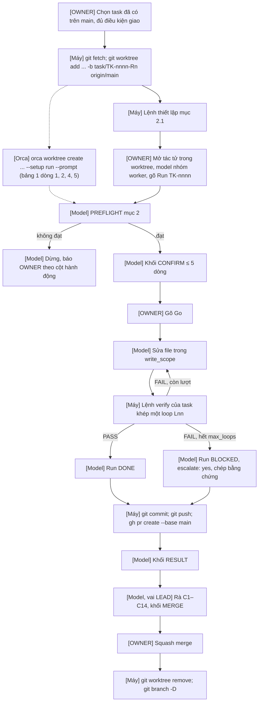
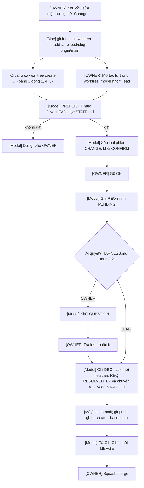
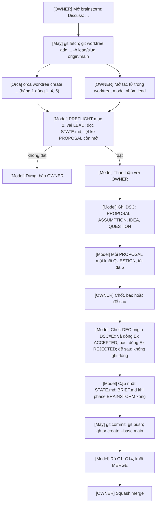

# INTEGRATION — GHÉP HARNESS VỚI ORCA VÀ 9ROUTER

Tài liệu này ghép ba giai đoạn trước (bộ khung repo, bộ nhớ và log, danh mục script) thành một khung dựng được trên máy trạm, theo `harness/HARNESS.md` mục 2, 7, 10, 11.

Nguyên tắc ghép:

- Harness không phụ thuộc Orca hay 9Router [HARNESS.md mục 2]. Mọi bước của luồng phiên ở mục 4 chạy được chỉ với Git, GitHub CLI (`gh`) và một tác tử dòng lệnh bất kỳ.
- Một tính năng của Orca hay 9Router chỉ được dùng thay cho bước Git/CLI tương ứng khi bảng 1 ghi "đã xác nhận" cho tính năng đó. Hiện chưa tính năng nào được xác nhận.
- Lệnh viết cho Windows (PowerShell). Đường dẫn trong repo viết bằng `/`; đường dẫn trên máy viết bằng `\`.

## 1. Bảng xác nhận tính năng

<!-- ANCHOR: FEATURES -->
Tài liệu đã đọc ngày 2026-11-11:

| Phần mềm | Trang đã đọc | Cách đọc |
|---|---|---|
| Orca (Stably AI) | `https://onorca.dev/docs/model/worktrees` · `https://onorca.dev/docs/cli/reference` · `https://onorca.dev/docs/settings` · `https://onorca.dev/docs/migrate-from-conductor` | Đọc trực tiếp |
| Orca (Stably AI) | `https://github.com/stablyai/orca` (README) · `https://github.com/stablyai/orca/issues/9206` | Trang repo không mở được trực tiếp; chỉ đọc đoạn trích qua máy tìm kiếm |
| 9Router (decolua) | `https://github.com/decolua/9router` (README) | Đọc bản sao README qua `https://cdn.jsdelivr.net/gh/decolua/9router@master/README.md`, nhánh `master` |

Có nhiều dự án khác cũng tên Orca hoặc 9Router (ví dụ `orca-cli/orca`, các bản fork của 9Router); bảng này không dùng tài liệu của các dự án đó. Chưa chắc hai phần mềm trên là đúng bản OWNER đang cài: OWNER kiểm phần nhận diện ở đầu `harness/tools/PREFLIGHT.md` mục 3 trước mọi dòng khác. Tài liệu có ghi một tính năng cũng không chứng minh bản đang cài có tính năng đó, nên mọi dòng đều ở trạng thái "chưa", cần OWNER kiểm.

| # | Công cụ | Tính năng khung dựa vào | Tài liệu chính thức nói gì | Trạng thái | Nguồn | Khi chưa xác nhận, thay bằng |
|:---:|---|---|---|---|---|---|
| 1 | Orca | Mỗi task một worktree | Mỗi worktree tạo bằng `git worktree`, mỗi task một bản checkout riêng trên đĩa | Chưa, cần OWNER kiểm | `onorca.dev/docs/model/worktrees` | `git worktree add` (`harness/GIT_CONVENTIONS.md` mục 5) |
| 2 | Orca | Lệnh thiết lập khi tạo worktree | `scripts.setup` trong `orca.yaml` ở gốc repo chạy ngay sau khi tạo worktree; cài đặt "Auto-run commands on worktree create" (Repository); cờ CLI `--setup run\|skip\|inherit`. Biến `ORCA_ROOT_PATH`, `ORCA_WORKTREE_PATH` có trong trang chuyển từ Conductor, nhưng issue #9206 (bản 1.4.144, WSL) báo hai biến này không có | Chưa, cần OWNER kiểm | `onorca.dev/docs/migrate-from-conductor`, `onorca.dev/docs/settings`, `onorca.dev/docs/cli/reference` | Chạy tay lệnh thiết lập ở mục 2.1 ngay sau `git worktree add` |
| 3 | Orca | Nơi đặt worktree | Worktree mới nằm trong "workspace folder" của Orca; tài liệu không nêu đường dẫn mặc định hay tên cài đặt | Chưa, cần OWNER kiểm | `onorca.dev/docs/migrate-from-conductor` | Tự chỉ định `<worktree-dir>` trong lệnh `git worktree add` |
| 4 | Orca | Đặt đúng tên nhánh | Ô "Branch name" trong ngăn Advanced; cờ CLI `--branch` đặt tên nhánh "không kèm tiền tố đã cấu hình", Orca có thể thêm hậu tố số khi trùng tên | Chưa, cần OWNER kiểm | `onorca.dev/docs/model/worktrees`, `onorca.dev/docs/cli/reference` | `git worktree add … -b task/TK-nnnn-Rn` |
| 5 | Orca | Giao task cho tác tử bằng một lệnh | `orca worktree create --name … --agent … --prompt "…"` mở tác tử trong worktree mới và gửi prompt. CLI phải được đăng ký trước; hai trang tài liệu ghi hai chỗ khác nhau (Settings → Experimental → CLI và Settings → General → Orca CLI). Cờ chọn nhánh gốc `--base` không có trong tài liệu | Chưa, cần OWNER kiểm | `onorca.dev/docs/cli/reference`, `onorca.dev/docs/settings` | OWNER mở tác tử trong thư mục worktree rồi gõ `Run TK-nnnn` |
| 6 | Orca | Biết tác tử đã xong | Không có sự kiện "xong" tường minh; có `orca terminal wait --for tui-idle` và "Agent status hooks" | Chưa, cần OWNER kiểm | `onorca.dev/docs/cli/reference`, `onorca.dev/docs/settings` | OWNER đọc khối `RESULT` cuối phiên |
| 7 | 9Router | Nhóm model (combo) | Dashboard → Combos → Create New: đặt tên, liệt kê model theo thứ tự ưu tiên; công cụ gọi combo bằng tên | Chưa, cần OWNER kiểm | README `decolua/9router` | OWNER chọn model trực tiếp trong công cụ tác tử theo bảng 3.1 |
| 8 | 9Router | Chuyển model dự phòng | Tự chuyển sang model kế tiếp trong combo khi hết hạn mức hoặc gặp lỗi | Chưa, cần OWNER kiểm | README `decolua/9router` | Không dùng combo nhiều model; mỗi phiên một model cố định |
| 9 | 9Router | Nhật ký ghi model thực tế của phiên | Usage Analytics theo dõi token theo nhà cung cấp và model; nhật ký request đầy đủ chỉ có khi đặt `ENABLE_REQUEST_LOGS=true` (mặc định `false`), ghi vào thư mục `logs/` của bản cài. README không nói rõ mỗi request có ghi model thực sự đã phục vụ hay không | Chưa, cần OWNER kiểm | README `decolua/9router` | Ghi tên model công cụ tác tử hiển thị (`harness/rules/WORKER.md` luật 10, 14) |
| 10 | 9Router | Liệt kê model và combo | `GET /v1/models` trả mọi model và combo; địa chỉ mặc định `http://localhost:20128/v1` | Chưa, cần OWNER kiểm | README `decolua/9router` | Xem trang Combos trên Dashboard |

**Đổi trạng thái sang "đã xác nhận":** OWNER làm đúng mục kiểm tương ứng trong `harness/tools/PREFLIGHT.md` mục 3 trên bản đang cài, ghi số phiên bản. LEAD sửa dòng đó (trạng thái, phiên bản, ngày kiểm) trong một PR `lead: …`; OWNER merge. Bản cài nâng cấp thì kiểm lại các dòng đã xác nhận.
<!-- END: FEATURES -->

## 2. Cấu hình Orca

### 2.1. Lệnh thiết lập khi tạo worktree

<!-- ANCHOR: ORCA_SETUP -->
Lệnh thiết lập chạy trong worktree vừa tạo, trước khi tác tử bắt đầu. Nó chỉ chuẩn bị môi trường và kiểm nền; không sửa file nào của repo.

| Giai đoạn | Lệnh thiết lập | Ghi chú cách chạy |
|---|---|---|
| Chưa có script `doctor` | `git status --short --branch` rồi lệnh cài phụ thuộc của dự án (ví dụ dự án Python: `python -m pip install -r requirements.txt`) | Tác tử làm tiếp các mục kiểm đầu phiên của `PREFLIGHT.md` mục 2 |
| Đã có `doctor` (`harness/tools/BUILD_TASKS.md`) | `python harness/tools/doctor.py` rồi lệnh cài phụ thuộc | `doctor` trả mã thoát khác 0 thì không giao task vào worktree đó |

- Lệnh chỉ dùng `git` và `python`, không dùng biến môi trường của Orca (bảng 1 dòng 2), nên chạy được trên cmd, PowerShell và bash.
- Bộ nhớ đệm tải gói dùng chung ở `<project>.local\cache\` [HARNESS.md mục 5.5]: OWNER đặt một lần cho cả máy, ví dụ `setx PIP_CACHE_DIR "<workspace>\<project>.local\cache\pip"`; lệnh thiết lập không cần biết đường dẫn này.
- Đặt lệnh trong cài đặt theo repo của Orca ("Auto-run commands on worktree create"), không thêm `orca.yaml` vào repo. Muốn dùng `orca.yaml` thì cần một `DEC`, vì đó là file mới ở gốc repo, ngoài cây thư mục của HARNESS.md mục 5.1.
<!-- END: ORCA_SETUP -->

### 2.2. Quy ước đặt tên

<!-- ANCHOR: ORCA_NAMING -->
| Thứ | Nguồn | Quy ước |
|---|---|---|
| Nhánh | `harness/GIT_CONVENTIONS.md` mục 1 (đã chốt) | `task/TK-nnnn-Rn` · `lead/<slug>` · `review/CYC-nn-Rk-xxxx` · `upgrade/<version>` |
| Thư mục worktree của task | `harness/GIT_CONVENTIONS.md` mục 5 (đã chốt) | `<worktree-dir>\TK-nnnn-Rn` |
| `<worktree-dir>` | Chưa có quy ước; tài liệu Orca không nêu (bảng 1 dòng 3) | Cần OWNER kiểm và chọn. Điều kiện bắt buộc: nằm ngoài bản checkout chính và ngoài `<project>.local\` [HARNESS.md mục 5.2] |
| Tên workspace trên Orca | Chưa có quy ước; tài liệu Orca chỉ nói tên nhánh mặc định lấy từ tên workspace (bảng 1 dòng 4) | Cần OWNER kiểm. Khung không dựa vào tên workspace; chỉ dựa vào tên nhánh |
| Nhánh gốc | `harness/GIT_CONVENTIONS.md` mục 5 | Luôn là `origin/main` vừa `git fetch` |
| Nhóm model của tác tử | Mục 3.1, OWNER đã duyệt | `lead` · `worker` · `reviewer` |

Orca có thể thêm tiền tố hoặc hậu tố số vào tên nhánh (bảng 1 dòng 4). Sau khi tạo worktree, tác tử luôn kiểm `git branch --show-current` khớp đúng tên nhánh (`PREFLIGHT.md` mục 2, dòng 2) trước khi làm.
<!-- END: ORCA_NAMING -->

### 2.3. Giao một task cho một tác tử

<!-- ANCHOR: ORCA_ASSIGN -->
Một task một worktree, một worktree một phiên tác tử, một phiên một task [THY-50]. Nhiều task chỉ được giao cùng lúc khi chúng cùng một batch của plan (`harness/HARNESS.md#BATCH_RULES`). Prompt giao việc luôn đúng một dòng `Run TK-nnnn`; tác tử tự định tuyến tới `harness/rules/WORKER.md` qua `AGENTS.md`, `CLAUDE.md` hoặc `GEMINI.md`.

Cách dùng hiện tại (không phụ thuộc tính năng chưa xác nhận):

```powershell
git -C <checkout> fetch origin
git -C <checkout> worktree add <worktree-dir>\TK-0007-R1 -b task/TK-0007-R1 origin/main
cd <worktree-dir>\TK-0007-R1
git status --short --branch
```

Sau đó OWNER mở tác tử trong thư mục này (một terminal trên Orca hoặc terminal thường), chọn model thuộc nhóm của WORKER (mục 3.1), rồi gõ `Run TK-0007`.

Cách dùng khi bảng 1 dòng 1, 2, 4, 5 đã xác nhận và nhánh gốc mặc định của repo trên Orca là `origin/main`:

```powershell
orca worktree create --name TK-0007-R1 --branch task/TK-0007-R1 --agent <agent-id> --prompt "Run TK-0007" --setup run --json
```

Số run `n` = 1 + số run lớn nhất của task đã có trên `main` (`PREFLIGHT.md` mục 2, dòng 12). Dọn worktree sau khi OWNER merge: `git worktree remove` như `harness/GIT_CONVENTIONS.md` mục 5; Orca tự dọn trạng thái của nó ở lần làm mới kế tiếp (`onorca.dev/docs/model/worktrees`).
<!-- END: ORCA_ASSIGN -->

## 3. Cấu hình 9Router

### 3.1. Ba nhóm model

<!-- ANCHOR: MODEL_GROUPS -->
Mỗi vai một combo trên 9Router (bảng 1 dòng 7). Ba tên `lead`, `worker`, `reviewer` dưới đây không lấy từ tài liệu 9Router (9Router để người dùng tự đặt tên combo); OWNER đã duyệt (mục 6, câu 2). Công cụ tác tử trỏ tới `http://localhost:20128/v1` và gọi đúng tên combo của vai. Khóa API của 9Router là Zone 3: chỉ nằm trong trình quản lý bí mật hoặc biến môi trường trên máy, không bao giờ vào repo.

| Combo | Dùng cho | Thành phần |
|---|---|---|
| `lead` | Phiên `ASK`, `CHANGE`, `DISCUSS` và điều phối | Model suy luận mạnh [HARNESS.md mục 3.1]; dự phòng cùng mức |
| `worker` | Phiên `RUN` | Model làm code hoặc viết; dự phòng rẻ hơn được phép |
| `reviewer` | Phiên kiểm định chu kỳ | Model khác mọi model trong `worker`, nên khác hãng [THY-23] |

**Quy tắc tách `reviewer` khỏi `worker`:**

1. Không model nào, kể cả model dự phòng, nằm trong cả `worker` lẫn `reviewer`. Vì 9Router có thể chuyển model giữa phiên (bảng 1 dòng 8), tách theo danh sách đầy đủ mới bảo đảm REVIEWER khác model với WORKER dù model dự phòng đã chạy.
2. `lead` được trùng với `worker` hoặc `reviewer`; LEAD không nghiệm thu chu kỳ.
3. OWNER sửa combo trên Dashboard. Sửa làm `worker` và `reviewer` có model chung là sai quy tắc 1; nếu không tránh được, LEAD ghi một `DEC` nêu chu kỳ bị ảnh hưởng và câu 2 cổng PASS của chu kỳ đó trả `CONDITIONAL` kèm một `RSK`.
4. Kiểm quy tắc 1 ở đầu mỗi phiên kiểm định: `PREFLIGHT.md` mục 2, dòng 13.

Thành phần của mỗi combo chỉ gồm các mã model mà `04_control/MODEL_MATRIX.md` cho phép đối với vai đó; ma trận và `harness/MODEL_POLICY.md` là nguồn tra cứu, combo là cách thi hành trên 9Router.

Khi chưa xác nhận combo: OWNER giữ trên máy một bảng tay gồm ba nhóm trên và chọn model cố định cho mỗi phiên theo bảng đó; quy tắc 1–4 giữ nguyên.
<!-- END: MODEL_GROUPS -->

### 3.2. Lấy model thực tế của một phiên

<!-- ANCHOR: SESSION_MODEL -->
| Cách | Phụ thuộc | Ai làm | Ghi vào |
|---|---|---|---|
| A. Tên model công cụ tác tử hiển thị trong phiên | Không | Tác tử, cuối phiên | `model` của run, `DSC`; `reviewer_model` của `RVW` |
| B. Usage Analytics trên Dashboard 9Router, lọc theo khoảng thời gian của phiên | Bảng 1 dòng 9 | OWNER, khi cần đối chiếu | Không ghi repo; sai khác với A thì LEAD ghi một `RSK` |
| C. Nhật ký request của 9Router (`ENABLE_REQUEST_LOGS=true`) | Bảng 1 dòng 9 | OWNER, chỉ bật khi điều tra | Không ghi repo; nhật ký chứa nội dung prompt nên là Zone 2, xóa sau khi xem |
| D. Script `budget` đọc nguồn B | Bảng 1 dòng 9 và `budget` đã có | Tác tử, cuối phiên | `model`, `usage` của run |

Hiện dùng cách A. Quy tắc 1 ở mục 3.1 là bảo đảm chính cho việc REVIEWER khác model với WORKER; cách A–D chỉ để đối chiếu [DC-22].
<!-- END: SESSION_MODEL -->

## 4. Luồng một phiên

Nhãn đầu mỗi bước cho biết ai làm: **[Máy]** lệnh `git`, `gh` hoặc script, không cần model suy nghĩ · **[Model]** tác tử theo vai · **[OWNER]** con người · **[Orca]** bước Orca thay được, chỉ dùng khi dòng ghi trong ngoặc của bảng 1 đã xác nhận. Đường nét liền là luồng chuẩn; đường nét đứt là bước Orca thay thế, không bắt buộc. Kiểm tra đầu phiên là `harness/tools/PREFLIGHT.md`.

### 4.1. Phiên `RUN`

<!-- ANCHOR: FLOW_RUN -->


| Bước | Ai | Việc cụ thể |
|---|---|---|
| Chọn task | OWNER | Task có trên `main`; mọi task trong `depends_on` đã `DONE`; `write_scope` không chồng với task đang chạy |
| Tạo worktree | Máy | Lệnh ở mục 2.3; số run theo `PREFLIGHT.md` mục 2, dòng 12 |
| Kiểm đầu phiên | Model | `PREFLIGHT.md` mục 2 với vai WORKER |
| Làm và kiểm | Model, Máy | `harness/rules/WORKER.md` luật 4–9; mỗi lần chạy `verify` là một loop |
| Nộp | Máy | Tiêu đề PR `TK-nnnn Rn: <goal>` |
| Review và merge | Model (LEAD), OWNER | `harness/rules/LEAD.md` luật 27; chỉ OWNER bấm merge |
<!-- END: FLOW_RUN -->

### 4.2. Phiên `CHANGE`

<!-- ANCHOR: FLOW_CHANGE -->


| Bước | Ai | Việc cụ thể |
|---|---|---|
| Xếp loại | Model | Phân vân giữa `ASK` và `CHANGE` thì xếp `CHANGE` [THY-10] |
| Ghi sổ | Model | `harness/rules/LEAD.md` luật 9–14; `DEC` mâu thuẫn một `DEC` đang `ACTIVE` thì ghi `supersedes` và chuyển `DEC` cũ vào `superseded/` trong cùng PR |
| Nộp | Máy | Tiêu đề PR `lead: <việc>` |
<!-- END: FLOW_CHANGE -->

### 4.3. Phiên `DISCUSS`

<!-- ANCHOR: FLOW_DISCUSS -->


| Bước | Ai | Việc cụ thể |
|---|---|---|
| Ghi `DSC` | Model | `harness/rules/LEAD.md` luật 17–19; ≤ 40 dòng, mỗi sự kiện ≤ 25 từ |
| Chốt | OWNER | Quyết định chỉ có hiệu lực khi có `DEC` trên `main` |
| Nộp | Máy | Một PR gồm `DSC` + `DEC` + `STATE.md` (luật 20) |
<!-- END: FLOW_DISCUSS -->

## 5. Điều phần tích hợp này không làm

- Không thêm file cấu hình Orca hay 9Router vào repo; cấu hình nằm trên máy.
- Không cho Orca hay 9Router merge, đẩy thẳng vào `main` hay bật auto-merge. Tính năng tạo PR trong Orca, nếu dùng, vẫn đi qua khối `MERGE` và lượt merge của OWNER.
- Không để nhật ký của 9Router, transcript của Orca hay dữ liệu tạm vào worktree; chúng thuộc `<project>.local\` hoặc thư mục của công cụ [HARNESS.md mục 5.2, 5.3].

## 6. Câu trả lời của OWNER (2026-11-11)

<!-- ANCHOR: OWNER_ANSWERS -->
| # | Câu hỏi | OWNER chọn | Áp dụng ở |
|---|---|---|---|
| 1 | Thông điệp cuối có được kèm khối `QUESTION` trước khối cuối không | Được, tối đa 5 khối, như `harness/templates/BLOCKS.md` | `BLOCKS.md` giữ nguyên |
| 2 | Tên ba nhóm model trên 9Router | `lead` · `worker` · `reviewer` | Mục 3.1 |
| 3 | Chỗ đặt phần mở rộng riêng của dự án | V1.0 chưa cho thêm; bản khung 1.1.0 tách ra thư mục riêng ngoài `harness/` | `harness/extensions/README.md` |
| 4 | Viết code script ở đâu | Repo phát triển riêng, `product_paths: ["tools/"]`; chép vào repo mẫu bằng PR `upgrade/<version>` | `harness/tools/BUILD_TASKS.md` mục 1 |

Việc còn lại cho PR nâng phiên bản khung: bổ sung câu 1 vào `harness/HARNESS.md` mục 3.4; ba tên ở câu 2 vào Phụ lục A; câu 3 vào mục 5.1 và 11.
<!-- END: OWNER_ANSWERS -->
